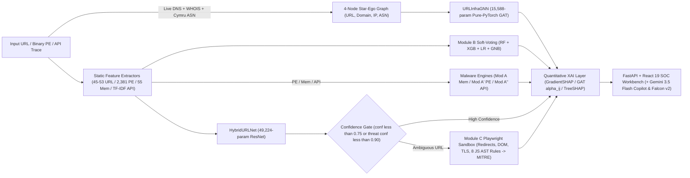

# CyberXAI — Explainable Multi-Class Malicious URL & Malware Detection Platform

**CyberXAI** is an end-to-end, explainable cybersecurity threat intelligence platform combining **deep learning (`HybridURLNet`)**, **heterogeneous graph attention networks (`URLInfraGNN`)**, **classical soft-voting ensembles**, **malware forensics classifiers** (memory dumps, static PE headers, and Windows API call sequences), an **autonomous Playwright dynamic browser sandbox agent**, **CrowdStrike Falcon Sandbox (Hybrid Analysis v2)** integration, and a **Google Gemini 3.5 Flash SOC Analyst Copilot** behind a **React 19 + FastAPI** workbench.

Every URL and malware verdict is paired with sub-second quantitative explainability (**GradientSHAP**, **Layer-2 GAT Attention $\alpha_{ij}$**, and **TreeSHAP**), while large model checkpoints are hosted securely in a **private Hugging Face Model Hub repository** ([`siddudavant/cyberxai-models`](https://huggingface.co/siddudavant/cyberxai-models)) with automatic on-demand hydration via [`src/model_registry.py`](src/model_registry.py).

### Quick Project Links

| Resource | Repository / Endpoint | Visibility |
| :--- | :--- | :--- |
| **GitHub Source Code** | [`Robotking007/Explainable-Multi-Class-Malicious-URL-Detection-Using-Hybrid-Features-and-Ensemble-Machine-Learning`](https://github.com/Robotking007/Explainable-Multi-Class-Malicious-URL-Detection-Using-Hybrid-Features-and-Ensemble-Machine-Learning) | Public |
| **Hugging Face Model Registry** | [`siddudavant/cyberxai-models`](https://huggingface.co/siddudavant/cyberxai-models) *(31 synced model/scaler/metric artifacts)* | **Private** (`HF_TOKEN`) |
| **Kaggle Combined URL Corpus** | [`robotking007/cyberxai-combined-urls`](https://www.kaggle.com/datasets/robotking007/cyberxai-combined-urls) · [`siddudavant/cyberxai-combined-urls`](https://www.kaggle.com/datasets/siddudavant/cyberxai-combined-urls) | Private Compute Datasets |
| **Kaggle MalAPI2019 Mirror** | [`siddudavant/cyberxai-malapi2019`](https://www.kaggle.com/datasets/siddudavant/cyberxai-malapi2019) | Private Compute Dataset |

---

## Abstract

Malicious URLs and evasive binary malware remain primary vectors for credential phishing, drive-by payload delivery, web defacement, and enterprise compromise. Conventional security systems suffer from three recurring limitations: *(i)* brittle blacklist reactivity and single-source dataset noise (label polarity inversions, stale captures, and heavy class imbalance), *(ii)* heavy batch-ensemble memory explosion at multi-million-URL scale alongside zero native interpretability across graph and deep neural detectors, and *(iii)* fragmented tooling that isolates static URL lexicons from underlying network infrastructure, volatile memory forensics, Portable Executable (PE) telemetry, and live DOM execution behavior.

To overcome these gaps, this work presents **CyberXAI**, a unified, explainable multi-class URL and malware threat intelligence platform spanning three coordinated analytical layers. First, we engineer deterministic SQLite- and metadata-priority data consolidation pipelines merging up to **32 public URL threat feeds and research corpora** (`13.22M` to `27.06M` deduplicated records across `benign`, `phishing`, `defacement`, and `malware`) alongside four canonical malware benchmarks (**CIC-MalMem-2022**, **BODMAS**, **EMBER-2018**, and **MalAPI2019**). Second, we design a compact `53`-feature hybrid URL vector (lexical, host, keyword, structural, information-theoretic, and live Abuse.ch IOC intelligence), a lightweight **49,224-parameter Residual Neural Network (`HybridURLNet`)**, a **15,588-parameter pure-PyTorch Heterogeneous Graph Attention Network (`URLInfraGNN`)** modeling `(URL <-> Domain <-> IP <-> ASN)` relations, and three parallel Random Forest / XGBoost malware forensics engines (**Modules A, A', A''**). Third, every prediction returns sub-second quantitative explanations via **GradientSHAP**, **Layer-2 GAT edge attention ($\alpha_{ij}$)**, and **TreeSHAP**, while ambiguous detections automatically escalate to a confidence-gated **Playwright Chromium dynamic browser sandbox** mapped to **MITRE ATT&CK** JavaScript AST signatures.

Empirically, `URLInfraGNN` and `HybridURLNet` achieve **89.77%** (`0.8947` Macro F1) and **89.46%** (`0.8916` Macro F1) multi-class accuracy—outperforming classical soft-voting ensembles by **+4.94% to +7.92%** accuracy and **+0.078 to +0.084** Macro F1 without multi-gigabyte SMOTE overhead. A controlled `4,999`-URL ablation validates that appending live WHOIS attributes (`73.24%` lookup availability) boosts ensemble accuracy by **+2.40%** (`79.20%` to `81.60%`, `+0.0269` Macro F1). Across malware binaries, **Module A** reaches **100.00% binary accuracy** (`87.81%` 4-family accuracy) on `CIC-MalMem-2022`, **Module A'** achieves **98.11%** internal (`0.9982` ROC-AUC) and **96.64%** unseen temporal external generalization (`0.9942` ROC-AUC) across `199,956` held-out `EMBER-2018` samples, and **Module A''** attains **0.9175 Macro ROC-AUC** over `MalAPI2019` API traces.

### Keywords

`Malicious URL Detection` · `Explainable AI (XAI)` · `Graph Attention Networks (GAT)` · `Tabular Residual Neural Networks` · `GradientSHAP` · `TreeSHAP` · `Malware Memory Forensics` · `Static PE Analysis` · `Windows API Call Sequences` · `WHOIS & BGP/ASN Threat Intelligence` · `Headless Browser Sandboxing` · `MITRE ATT&CK`

---

## Table of Contents

1. [Abstract & Keywords](#abstract)
2. [Repository Layout](#repository-layout)
3. [Literature Review](#literature-review)
   - [Comparative Survey of Prior Work](#1-comparative-survey-of-prior-work)
   - [Research Gaps & CyberXAI Contributions](#2-research-gaps--cyberxai-contributions)
4. [Methodology & System Architecture](#methodology--system-architecture)
   - [End-to-End Platform Architecture](#1-end-to-end-platform-architecture)
   - [URL Classification Formulations (HybridURLNet, URLInfraGNN, Module B)](#2-url-classification-formulations)
   - [Live Host Intelligence & Confidence-Gated Dynamic Sandbox (Module C)](#3-live-host-intelligence--confidence-gated-dynamic-sandbox-module-c)
   - [Malware Forensics Pipeline (Modules A, A', A'')](#4-malware-forensics-pipeline-modules-a-a-a)
   - [Quantitative Explainable AI Formulations](#5-quantitative-explainable-ai-formulations)
5. [Experimental Results, Comparison Tables & Discussion](#experimental-results-comparison-tables--discussion)
   - [URL Classification Models Comparison](#1-url-classification-models-comparison)
   - [Per-Class URL Performance Comparison](#2-per-class-url-performance-comparison)
   - [WHOIS Feature Ablation Study Comparison](#3-whois-feature-ablation-study-comparison)
   - [Malware Analysis Modules Comparison (Module A, A', A'')](#4-malware-analysis-modules-comparison-module-a-a-a)
   - [Malware Per-Class Family Breakdown](#5-malware-per-class-family-breakdown)
   - [Analytical Discussion & Error Analysis](#6-analytical-discussion--error-analysis)
6. [Detailed Explanation of All Engineered & Runtime Features](#detailed-explanation-of-all-engineered--runtime-features)
   - [Feature Architecture Overview](#feature-architecture-overview)
   - [Group 1: Lexical URL Features (15 Features)](#group-1-lexical-url-features-15-features)
   - [Group 2: Host & Domain Structure Features (11 Features)](#group-2-host--domain-structure-features-11-features)
   - [Group 3: Content-Keyword Features (4 Features)](#group-3-content-keyword-features-4-features)
   - [Group 4: Structural URL Features (7 Features)](#group-4-structural-url-features-7-features)
   - [Group 5: Statistical & Information-Theoretic Features (8 Features)](#group-5-statistical--information-theoretic-features-8-features)
   - [Group 6: Abuse.ch Threat Intelligence Features (8 Features)](#group-6-abusech-threat-intelligence-features-8-features)
   - [Group 7: URLInfraGNN Heterogeneous Graph Features](#group-7-urlinfragnns-heterogeneous-graph-features)
   - [Group 8: Live Host Intelligence Features — WHOIS & ASN/BGP (10 Features)](#group-8-live-host-intelligence-features--whois--asnbgp-10-features)
   - [Group 9: Dynamic Browser Sandbox & Autonomous AI Agent Telemetry](#group-9-dynamic-browser-sandbox--autonomous-ai-agent-telemetry)
   - [Group 10: Malware Feature Spaces (Memory, Static PE, API Sequences)](#group-10-malware-feature-spaces-memory-static-pe-api-sequences)
7. [Platform & Application Features](#platform--application-features)
   - [React 19 SOC Web Dashboard](#1-react-19-soc-web-dashboard-frontend)
   - [FastAPI Backend REST API](#2-fastapi-backend-rest-api-srcapimainpy)
   - [Explainable AI (XAI) Engine Comparison](#3-explainable-ai-xai-engine-comparison)
   - [External Threat Intelligence & AI Services](#4-external-threat-intelligence--ai-services)
8. [Dataset Corpus & Threat Feed Consolidation](#dataset-corpus--threat-feed-consolidation)
   - [Consolidated Corpus Distributions](#1-consolidated-corpus-distributions)
   - [Live Threat Intelligence Feeds & Allowlists](#2-live-threat-intelligence-feeds--allowlists)
   - [URL Benchmark Corpora, Polarity Handling & Exclusions](#3-url-benchmark-corpora-polarity-handling--exclusions)
   - [Malware Forensics, Static PE & API Sequence Datasets](#4-malware-forensics-static-pe--api-sequence-datasets)
9. [Private Hugging Face Model Registry & Cloud Compute Links](#private-hugging-face-model-registry--cloud-compute-links)
10. [MLOps, CI/CD, Kaggle Cloud Compute & Green Computing](#mlops-cicd-kaggle-cloud-compute--green-computing)
11. [Quick Start & Usage](#quick-start--usage)
12. [Conclusion & Future Work](#conclusion--future-work)
13. [Research Paper & Benchmark Dataset References](#research-paper--benchmark-dataset-references)
    - [Literature-to-CyberXAI Module Mapping](#1-literature-to-cyberxai-module-mapping)
    - [Detailed Research Paper References](#2-detailed-research-paper-references)
    - [Threat Intelligence Feeds & Standards Links](#3-threat-intelligence-feeds--standards-links)

---

## Repository Layout

```text
Dataset/                             Multi-GB training datasets & threat feeds (gitignored)
models/                              Trained .pt, .joblib, and .json checkpoints (gitignored; synced with private HF Hub)
reports/                             Evaluation metrics JSONs, scan_history.json, and training logs (gitignored)

dags/
  cyberxai_ml_training_dag.py        5-stage Apache Airflow MLOps pipeline DAG (with standalone fallback runner)
  tasks/                             data_validation.py, feature_engineering.py, model_training.py,
                                     model_evaluation.py, model_registry_sync.py

scripts/
  sync_all_models_to_hf.py           Syncs all 31 active artifacts + Model Card to private HF Hub repo

src/
  api/
    main.py                          FastAPI server (URL, DL, GNN, XAI, Host Intel, Graph, Sandbox, Malware,
                                     Hybrid Analysis v2, History, Metrics, Chatbot, HF Registry)
    chatbot.py                       Google Gemini 3.5 Flash SOC assistant grounded in scan telemetry
  url_pipeline/
    features.py                      53-feature static URL + Abuse.ch extractor & char n-gram TF-IDF builder
    abuse_features.py                8-feature Abuse.ch ThreatFox + URLhaus singleton IOC matcher
    whois_features.py                5-feature live WHOIS lookup (cached per registered domain)
    asn_features.py                  5-feature live DNS + Team Cymru bulk-whois BGP/ASN lookup
    dl_model.py                      HybridURLNet (PyTorch Tabular Residual Network + INT8 dynamic quantization)
    train_dl.py / explain_dl.py      Mini-batch class-weighted PyTorch training & sub-second GradientSHAP explainer
    gnn_model.py                     URLInfraGNN (2-layer pure-PyTorch Graph Attention Network, no PyG/DGL C++ deps)
    gnn_graph_builder.py             4-node heterogeneous star-ego graph builder (URL <-> Domain <-> IP <-> ASN)
    train_gnn.py / explain_gnn.py    URLInfraGNN training & Layer-2 GAT attention attribution engine
    train.py / explain.py            Classical Soft-Voting Ensemble (RF + XGB + LR + GNB) & TreeSHAP explainer
    train_shap_surrogate.py          Shallow-RF TreeSHAP surrogate trainer for fast serving
    run_whois_ablation.py            Reproducible 5,000-URL WHOIS ablation benchmark
    build_combined_dataset.py        SQLite-backed priority-merged, deduplicated, sorted corpus builder
    merge_new_threat_data.py         Incremental deduplicated ThreatFox / PhishTank / URLhaus feed merger
    dynamic_escalation.py            Module C Playwright headless Chromium confidence-gated sandbox
    dynamic_agent.py                 Autonomous dynamic security agent (Playwright + fallback HTTP, 8 JS AST rules,
                                     MITRE ATT&CK mapping, DOM trap scan, TLS handshake verification, safe HTML)
    hybrid_analysis_client.py        CrowdStrike Falcon Sandbox (Hybrid Analysis API v2) client
    whois_bulk_enrich.py / asn_bulk_enrich.py   Checkpointed bulk domain enrichment pipelines
  malware_pipeline/
    train_dynamic_baseline.py        Module A: CIC-MalMem-2022 Volatility memory forensics (binary & 4-family)
    train_static_baseline.py         Module A': BODMAS + EMBER-2018 static PE analysis (2,381 features)
    train_api_sequence_baseline.py   Module A'': MalAPI2019 8-family Windows API sequence TF-IDF classifier
    explain.py / explain_static.py   TreeSHAP explainers for dynamic & static malware models
  model_registry.py                  Auto-downloads missing checkpoints from private HF Hub on demand
  upload_models.py                   CLI uploader for models/ -> private HF Hub repo
  fetch_abusech_data.py              Authenticated Abuse.ch ThreatFox + URLhaus exporter
  download_additional_datasets.py    Kaggle + OpenPhish feed downloader
  download_more_datasets.py          Kaggle + OpenPhish + Tranco Top 1M downloader
  merge_sort_datasets.py             17-source URL dataset consolidator with threat metadata & disk cleanup
  kaggle_*.py                        Self-contained Kaggle GPU/CPU training, enrichment & watcher utilities

frontend/
  src/                               React 19 + Vite 8 + Tailwind CSS 3 + ReactFlow + Recharts SOC Dashboard
  code.html                          Legacy standalone single-file HTML fallback served at GET /

.github/workflows/ci.yml             GitHub Actions syntax compile + full src/ import verification gate
docker-compose.airflow.yml           PostgreSQL + Apache Airflow 2.8.1 LocalExecutor stack
.env.example                         Configuration template for HF, Gemini, Abuse.ch, Kaggle, and Hybrid Analysis
```

---

## Literature Review

### 1. Comparative Survey of Prior Work

Research in automated web threat intelligence and malware triage has progressed through five major paradigms: lexical heuristics, domain registration/network profiling, deep tabular/graph neural representation learning, malware static/memory/API analysis, and axiomatic explainable AI (XAI). The table below synthesizes 16 representative peer-reviewed works and benchmark datasets alongside their documented methodologies and structural limitations:

| Work | Domain / Focus | Core Methodology & Dataset Scale | Key Strengths | Observed Limitations & Open Challenges |
| :--- | :--- | :--- | :--- | :--- |
| **Ma et al. (2009)** [[R2]](#research-paper--benchmark-dataset-references) | Proactive Malicious URLs | $L_1$-regularized online linear models combining lexical tokens + host properties (`DNS`/`ASN`/WHOIS) without fetching page content | Zero drive-by infection risk; adaptive online updates; high accuracy beyond static blacklists | Pre-neural linear modeling; lacks multi-class separation (`phishing` vs `defacement` vs `malware`) |
| **Mamun et al. (2016)** [[R3]](#research-paper--benchmark-dataset-references) | Multi-Class Lexical URLs (`ISCX-URL-2016`) | 79 lexical & obfuscation features evaluated across RF, C4.5, kNN, SVM (`>110k` URLs) | Standardizes multi-class lexical formulation and entropy analysis | Static-age capture without infrastructure graph modeling or neural attribution |
| **Le Pochat et al. (2019)** [[R8]](#research-paper--benchmark-dataset-references) | Research Top-Sites (`Tranco`) | Manipulation-hardened aggregation replacing volatile Alexa/Umbrella lists | Prevents adversarial domain list poisoning and spurious allowlisting | Domain popularity list only; must be paired with threat intelligence feeds |
| **Prasad & Chandra (2024)** [[R4]](#research-paper--benchmark-dataset-references) | Phishing Framework (`PhiUSIIL`) | Security-profile similarity index + incremental learning (`235,795` URL+HTML pairs) | High contemporary phishing accuracy (`>99%`) & rich DOM profile schema | Binary polarity (`1=benign`, `0=phishing`) causes silent inversions in naive multi-source merges; requires HTML fetch |
| **Dalton et al. (2025)** [[R5]](#research-paper--benchmark-dataset-references) | Temporal Phishing (`PhreshPhish`) | Real-world verified HTML-URL corpus (`666k+` recent captures through 2025–2026) | Eliminates legacy dataset staleness and broken links | Binary phishing vs benign scope only (excludes `defacement`/`malware` C2 feeds) |
| **Vu (2026)** [[R6]](#research-paper--benchmark-dataset-references) · **Jha et al. (2025)** [[R7]](#research-paper--benchmark-dataset-references) | Localized & Stealth Phishing (`PhishVN`, `StealthPhisher2025`) | Regional impersonation taxonomy (`53k+`) & statistical/fractal complexity URLs (`336.7k`) | Mitigates TLD geographic bias and lexical obfuscation attacks | Binary scope; lacks unified host-ASN graph reasoning |
| **Khedekar & Pawar (2026)** [[R1]](#research-paper--benchmark-dataset-references) | Feature Selection & WHOIS URLs | Feature selection (RFE, Chi²) + WHOIS registration age/privacy on `5,000` URLs (`+0.20%` F1 gain) | Empirically validates WHOIS lifespan signals | Evaluated at bounded `5k` scale because live port-43 WHOIS queries rate-limit severely at `10M+` scale |
| **Veličković et al. (2018)** [[R9]](#research-paper--benchmark-dataset-references) | Graph Representation (`GAT`) | Masked multi-head self-attention $\alpha_{ij}$ over arbitrary node neighborhoods | Inductive inference & interpretable neighbor edge importance | Standard PyG/DGL C++ ops introduce heavy environment fragility on cloud/edge hosts |
| **Gorishniy et al. (2021)** [[R11]](#research-paper--benchmark-dataset-references) | Tabular Deep Learning (`ResNet` / `FT-Transformer`) | Normalized residual MLP blocks tuned systematically against GBDTs [[R12]](#research-paper--benchmark-dataset-references)[[R13]](#research-paper--benchmark-dataset-references) | Closes neural-vs-GBDT performance gap under mini-batch GPU training | Requires structured numerical normalization & minority gradient handling on imbalanced corpora |
| **Lundberg et al. (2017, 2020)** [[R15]](#research-paper--benchmark-dataset-references)[[R16]](#research-paper--benchmark-dataset-references) · **Sundararajan et al. (2017)** [[R17]](#research-paper--benchmark-dataset-references) | Explainable AI (`SHAP` / `TreeSHAP` / `IG`) | Game-theoretic additive Shapley values, exact polynomial TreeSHAP, path-integral gradients | Locally consistent & globally aggregable feature attributions | Unconstrained Random Forests suffer `60–90s` single-sample TreeSHAP latency without depth bounds or surrogates |
| **Anderson & Roth (2018)** [[R20]](#research-paper--benchmark-dataset-references) · **Yang et al. (2021)** [[R19]](#research-paper--benchmark-dataset-references) · **Harang & Rudd (2020)** [[R23]](#research-paper--benchmark-dataset-references) | Static PE Malware (`EMBER`, `BODMAS`, `SOREL-20M`) | Standardized `2,381`-dim LIEF PE feature schema (`1.1M` / `134k` / `20M` binaries) | Enables cross-corpus temporal generalization testing | `SOREL-20M` (`515 GB+` `pe_metadata`) exceeds single-node lab storage; `EMBER` includes unlabeled (`-1`) rows requiring strict filtering |
| **Carrier et al. (2022)** [[R18]](#research-paper--benchmark-dataset-references) | Memory Forensics (`CIC-MalMem-2022`) | 55 `VolMemLyzer` volatility memory dump metrics across benign, spyware, trojan, ransomware (`58k`) | High binary separation of obfuscated/fileless malware | Pre-aggregated Volatility snapshots rather than live syscall timelines; family boundaries blur under shared packers |
| **Çatak et al. (2020)** [[R21]](#research-paper--benchmark-dataset-references) · **Bošanský et al. (2022)** [[R22]](#research-paper--benchmark-dataset-references) | Dynamic API & Sandbox (`MalAPI2019`, `Avast-CTU CAPE`) | Cuckoo 8-family PE API call sequences (`7,107` samples) & `48,976` CAPEv2 reports | Captures sequential Windows runtime semantics across families | `MalAPI2019` contains zero benign samples & overlaps heavily across Trojan/Backdoor/Dropper behaviors |

### 2. Research Gaps & CyberXAI Contributions

| Identified Gap in Prior Literature | How CyberXAI Explicitly Solves It |
| :--- | :--- |
| **Gap 1 — Cross-Corpus Label Corruption & Polarity Inversions:** Naive concatenation of public URL datasets introduces duplicates, adult-content noise, generic `"malicious"` labels, and silent `0/1` flips (e.g., `PhiUSIIL`, `harisudhan411`). | Implemented SQLite priority deduplication ([`build_combined_dataset.py`](src/url_pipeline/build_combined_dataset.py)) and `LABEL_PRIORITY`-ordered metadata enrichment ([`merge_sort_datasets.py`](src/merge_sort_datasets.py)), flipping inverted schemas, dropping `3.37M` out-of-taxonomy `adult` rows, and quarantining mislabelled noisy sets. |
| **Gap 2 — SMOTE & TF-IDF Memory Explosion at 20M+ Scale:** Applying SMOTE [[R14]](#research-paper--benchmark-dataset-references) + dense `float64` n-grams on tens of millions of URLs exceeds `30 GB` RAM and kills classical ensemble jobs. | Replaced synthetic oversampling on large corpora with compact class-weighted streaming PyTorch architectures (`HybridURLNet`: `49,224` params; `URLInfraGNN`: `15,588` params), shrinking model footprints from `82.6 MB` to `72.3–208.4 KB` while lifting accuracy by **+4.94% to +7.92%**. |
| **Gap 3 — WHOIS / ASN Rate-Limiting at Production Throughput:** Live WHOIS/DNS lookups block per-URL inference by `2–5s` and bottleneck millions of training rows [[R1]](#research-paper--benchmark-dataset-references). | Decoupled zero-network static scoring (`<0.4s` inference + GradientSHAP) from asynchronous cached live WHOIS/Cymru-ASN enrichment (`lru_cache=4096`) and validated WHOIS utility on a controlled stratified `4,999`-URL ablation (`+2.40%` accuracy). |
| **Gap 4 — Static Obfuscation Evasion & Siloed URL/Malware Triage:** Static lexical features alone cannot spot dynamic JS redirects, ClickFix PowerShell lures, keyloggers, or malicious PE attachments. | Built a confidence-gated **Playwright Chromium sandbox agent (`Module C`)** triggering when `conf < 0.75` or uncertain `phishing`/`malware` `< 0.90`, alongside three XAI-enabled binary/memory/API malware engines (**Modules A, A', A''**) and Falcon Sandbox integration. |

---

## Methodology & System Architecture

### 1. End-to-End Platform Architecture

CyberXAI operates as a decoupled multi-modal inspection pipeline combining sub-second static neural inference, structural infrastructure graph attention, confidence-gated dynamic browser detonation, malware forensics, and localized XAI:



### 2. URL Classification Formulations

Given a normalized URL string $u$, our feature extractor constructs a deterministic vector $\mathbf{x} \in \mathbb{R}^{45}$ (or $\mathbb{R}^{53}$ when live Abuse.ch ThreatFox/URLhaus IOC signals are attached):

1. **`HybridURLNet` (Tabular Residual Neural Network — [`dl_model.py`](src/url_pipeline/dl_model.py)):**
   Standardized features $\tilde{\mathbf{x}} = (\mathbf{x} - \boldsymbol{\mu}) / \boldsymbol{\sigma}$ are projected via `Linear(45, 128) -> BatchNorm1d -> SiLU -> Dropout(0.2)` into latent state $\mathbf{h}_0 \in \mathbb{R}^{128}$, passed through a residual transformation block:
   $$\mathbf{h}_1 = \mathbf{h}_0 + \text{BatchNorm}\!\left(\mathbf{W}_2 \, \text{Dropout}\!\left(\text{SiLU}\!\left(\text{BatchNorm}(\mathbf{W}_1 \mathbf{h}_0)\right)\right)\right), \qquad \mathbf{h}_{\text{out}} = \text{SiLU}(\mathbf{h}_1)$$
   followed by a `128 -> 64 -> 4` head minimizing inverse-frequency class-weighted Cross-Entropy loss $\mathcal{L}_{\text{CE}} = -\sum_{c=0}^{3} w_c y_c \log \hat{p}_c$ under AdamW optimization and mixed-precision mini-batch streaming. Linear layers additionally support dynamic `INT8` post-training quantization (`quantize_for_inference()`).

2. **`URLInfraGNN` (Heterogeneous Graph Attention Network — [`gnn_model.py`](src/url_pipeline/gnn_model.py), [`gnn_graph_builder.py`](src/url_pipeline/gnn_graph_builder.py)):**
   Each candidate URL is lifted into a 4-node heterogeneous star-ego graph $\mathcal{G} = (\mathcal{V}, \mathcal{E})$ with bidirectional adjacency $\mathbf{A}$ (plus self-loops) linking $\mathcal{V} = \{\text{URL} (45\text{d}),\ \text{Domain} (8\text{d}),\ \text{IP} (4\text{d}),\ \text{ASN} (4\text{d})\}$. Type-specific projections (`Linear -> LayerNorm -> SiLU`) align all four node modalities into a shared hidden space ($d=64$) before two masked pure-PyTorch Graph Attention Layers (`GraphAttentionLayer`, LeakyReLU slope $0.2$, dropout $0.15$):
   $$\alpha_{ij}^{(l)} = \frac{\exp\!\left(\text{LeakyReLU}\!\left(\mathbf{a}^{(l)\top}\!\left[\mathbf{W}^{(l)} \mathbf{h}_i^{(l)} \parallel \mathbf{W}^{(l)} \mathbf{h}_j^{(l)}\right]\right)\right)}{\sum_{k \in \mathcal{N}(i)} \exp\!\left(\text{LeakyReLU}\!\left(\mathbf{a}^{(l)\top}\!\left[\mathbf{W}^{(l)} \mathbf{h}_i^{(l)} \parallel \mathbf{W}^{(l)} \mathbf{h}_k^{(l)}\right]\right)\right)}, \qquad \mathbf{h}_i^{(l+1)} = \text{LayerNorm}\!\left(\mathbf{h}_i^{(l)} + \text{ELU}\!\left(\sum_{j \in \mathcal{N}(i)} \alpha_{ij}^{(l)} \mathbf{W}^{(l)} \mathbf{h}_j^{(l)}\right)\right)$$
   Logits over the 4 threat classes are decoded from the updated URL node representation $\mathbf{h}_{\text{URL}}^{(2)}$ while exporting $\alpha_{ij}^{(2)}$ directly for infrastructure attribution.

3. **Module B (Calibrated Soft-Voting Ensemble — [`train.py`](src/url_pipeline/train.py)) & Controlled WHOIS Ablation ([`run_whois_ablation.py`](src/url_pipeline/run_whois_ablation.py)):**
   Aggregates four heterogeneous learners—Random Forest (`max_depth=30`, `max_samples=0.3`), histogram-accelerated XGBoost, L2-regularized Logistic Regression, and Gaussian Naive Bayes—via weighted probability averaging over MinMax-scaled features (`50` hybrid+WHOIS features or `90` Top-30 + `60` char 2–3 gram TF-IDF baseline features). Following Khedekar & Pawar (2026, Section 4.6) [[R1]](#research-paper--benchmark-dataset-references), the WHOIS ablation isolates the exact marginal contribution of the 5 live WHOIS attributes (`whois_available`, `domain_age_days`, `registration_length_days`, `recent_domain_flag`, `whois_private_flag`) using identical splits (`n=4,999`), concurrent 20-worker registrar lookups, and SMOTE balancing.

### 3. Live Host Intelligence & Confidence-Gated Dynamic Sandbox (Module C)

To balance throughput and behavioral precision, live DNS resolution, Team Cymru BGP/ASN queries (`whois.cymru.com:43`), and registrar WHOIS metadata run asynchronously alongside cached static predictions (`lru_cache(maxsize=4096)`). Whenever static prediction confidence satisfies $\max_c \hat{p}_c < 0.75$ or a predicted threat (`phishing` / `malware`) exhibits uncertain margin $\max(\hat{p}_{\text{phish}}, \hat{p}_{\text{mal}}) < 0.90$, [`dynamic_escalation.py`](src/url_pipeline/dynamic_escalation.py) and [`dynamic_agent.py`](src/url_pipeline/dynamic_agent.py) launch a locked-down headless Chromium (`Playwright`) session (`accept_downloads=False`, zero permissions) with Requests fallback, tracing document redirects, inspecting `ssl.create_default_context()` TLS handshakes, extracting hidden-iframe / external-form / brand-title mismatches, computing normalized script entropy, and matching 8 JS AST patterns mapped to **MITRE ATT&CK** (`T1027`, `T1059.001`, `T1056.001`, `T1496`, `T1567.002`, `T1497.001`).

### 4. Malware Forensics Pipeline (Modules A, A', A'')

- **Module A — Volatile Memory Forensics ([`train_dynamic_baseline.py`](src/malware_pipeline/train_dynamic_baseline.py)):** Evaluates dual RF + XGBoost classifiers on all `55` `VolMemLyzer` features from `CIC-MalMem-2022` (`58,058` dumps; `80/20` stratified split) for both binary screening (`Benign` vs `Malware`) and 4-class family attribution (`Benign`, `Spyware`, `Trojan`, `Ransomware`).
- **Module A' — Temporal Static PE Analysis ([`train_static_baseline.py`](src/malware_pipeline/train_static_baseline.py)):** Streams `bodmas.parquet` (`134,428` samples) plus labeled `train_ember_2018_v2_features.parquet` (`599,920` labeled rows after removing `199,992` unlabeled `-1` rows) across `2,381` LIEF features (`F1..F2381`) into RF (`max_depth=16`) and GPU/hist XGBoost ensembles, evaluated both internally (`146,870` holdout) and on the temporally separated `test_ember_2018_v2_features.parquet` (`199,956` unseen binaries).
- **Module A'' — Windows API Sequence Analysis ([`train_api_sequence_baseline.py`](src/malware_pipeline/train_api_sequence_baseline.py)):** Converts `MalAPI2019` Cuckoo trace strings (`7,107` samples) into `500` word-level `1–3` gram TF-IDF features (`~334` API opcodes) classified across 8 malware families using RF and XGBoost.

### 5. Quantitative Explainable AI Formulations

| Model Family | Attribution Mechanism | Mathematical Basis | Operational Role |
| :--- | :--- | :--- | :--- |
| **`HybridURLNet`** | `GradientExplainer` ([`explain_dl.py`](src/url_pipeline/explain_dl.py)) | Expected gradient path Shapley approximation over neutral zero baseline [[R15]](#research-paper--benchmark-dataset-references)[[R17]](#research-paper--benchmark-dataset-references) | Real-time (`<0.4s`) per-feature push toward/away from threat verdict |
| **`URLInfraGNN`** | Native GAT Attention ([`explain_gnn.py`](src/url_pipeline/explain_gnn.py)) | Exact Layer-2 attention coefficients $\alpha_{\text{URL},j}^{(2)}$ across `{Self, Domain, IP, ASN}` [[R9]](#research-paper--benchmark-dataset-references) | Infrastructure causality share (lexical URL vs domain vs hosting IP/ASN) |
| **Modules B, A, A'** | `TreeExplainer` ([`explain.py`](src/url_pipeline/explain.py), [`malware_pipeline/explain*.py`](src/malware_pipeline/explain_static.py)) | Exact polynomial-time TreeSHAP ($O(TLD^2)$) [[R16]](#research-paper--benchmark-dataset-references) + shallow `max_depth=8` RF surrogate (`<35ms`) | Audits PE header, Volatility service/handle counts, and ensemble tree paths |

---

## Experimental Results, Comparison Tables & Discussion

All metrics reported below are read directly from the persisted evaluation artifacts in [`models/`](models/) and [`reports/`](reports/).

### 1. URL Classification Models Comparison

Four URL classification models were trained and benchmarked across the 4-class URL taxonomy (`benign`, `phishing`, `defacement`, `malware`):

| Model | Architecture | Input Feature Space | Train / Test Split | Accuracy | Macro Precision | Macro Recall | Macro F1 | Weighted F1 | Artifact Checkpoint |
| :--- | :--- | :--- | :--- | :---: | :---: | :---: | :---: | :---: | :--- |
| **`URLInfraGNN`** *(Best Overall)* | 2-Layer Pure-PyTorch Graph Attention Network (GAT) | 45 URL + 8 Domain + 4 IP + 4 ASN nodes | 85% / 15% (`25,145` test) | **89.77%** | **89.49%** | 89.45% | **0.8947** | **0.8980** | `url_gnn_model.pt` (`72.3 KB`) |
| **`HybridURLNet`** | Tabular Residual Neural Network (Linear + BatchNorm + SiLU + Skip) | 45 static hybrid URL features | 80% / 20% (`33,526` test) | **89.46%** | 89.04% | **89.47%** | **0.8916** | **0.8953** | `url_dl_model.pt` (`208.4 KB`) |
| **Soft-Voting Ensemble (Hybrid + WHOIS)** | RF + XGBoost + LogisticRegression + GaussianNB | 50 features (45 hybrid + 5 WHOIS) | `306,505` train / `76,627` test | **81.85%** | 83.19% | 81.52% | 0.8163 | 0.8148 | `url_voting_classifier.joblib` (`82.6 MB`) |
| **Soft-Voting Ensemble (90-Feat Baseline)** | RF + XGBoost + LogisticRegression + GaussianNB (SMOTE-balanced) | 90 features (Top-30 engineered + 60 char n-grams) | `4,670,696` train / `509,421` test | **84.83%** | 78.32% | 87.09% | 0.8103 | 0.8455 | `reports/url_module_b_metrics.json` (Macro AUC: **0.9641**) |

> **Key Takeaway:** Compact PyTorch neural architectures (`URLInfraGNN` at `72.3 KB` and `HybridURLNet` at `208.4 KB`) outperform the much larger classical soft-voting ensembles by **+4.94% to +7.92% accuracy** and **+0.078 to +0.084 Macro F1**, while eliminating multi-gigabyte SMOTE memory overhead and delivering sub-second inference.

### 2. Per-Class URL Performance Comparison

| Class | Metric | `URLInfraGNN` (`n=25,145`) | `HybridURLNet` (`n=33,526`) | Voting Ensemble 50-Feat (`n=76,627`) | Voting Ensemble 90-Feat (`n=509,421`) |
| :--- | :--- | :---: | :---: | :---: | :---: |
| **Benign** | Precision / Recall / **F1** | 0.8537 / 0.8712 / **0.8623** (`n=7,500`) | 0.8612 / 0.8579 / **0.8595** (`n=10,000`) | 0.6859 / 0.8058 / **0.7410** (`n=20,631`) | 0.8839 / 0.9242 / **0.9036** (`n=291,919`) |
| **Phishing** | Precision / Recall / **F1** | 0.8956 / 0.8886 / **0.8921** (`n=5,289`) | 0.9063 / 0.8708 / **0.8882** (`n=7,051`) | 0.8429 / 0.6073 / **0.7059** (`n=19,094`) | 0.8993 / 0.6545 / **0.7576** (`n=150,594`) |
| **Defacement** | Precision / Recall / **F1** | 0.8655 / 0.8728 / **0.8692** (`n=4,734`) | 0.8156 / 0.9173 / **0.8635** (`n=6,312`) | 0.8745 / 0.9911 / **0.9292** (`n=21,441`) | 0.6740 / 0.9583 / **0.7914** (`n=40,438`) |
| **Malware** | Precision / Recall / **F1** | 0.9648 / 0.9454 / **0.9550** (`n=7,622`) | 0.9785 / 0.9330 / **0.9552** (`n=10,163`) | 0.9243 / 0.8568 / **0.8893** (`n=15,461`) | 0.6756 / 0.9464 / **0.7884** (`n=26,470`) |

Error rates recorded for the 90-feature baseline (`reports/url_module_b_metrics.json`):
- **False Negative Rate (FNR):** Benign `7.58%` | Defacement `4.17%` | Malware `5.36%` | Phishing `34.55%` *(significantly mitigated by `URLInfraGNN` and `HybridURLNet`, which raised Phishing recall from `65.45%` to `88.86%` and `87.08%`, respectively)*
- **False Positive Rate (FPR):** Benign `16.30%` | Defacement `4.00%` | Malware `2.49%` | Phishing `3.08%`

### 3. WHOIS Feature Ablation Study Comparison

Evaluated via [`src/url_pipeline/run_whois_ablation.py`](src/url_pipeline/run_whois_ablation.py) on a stratified `4,999`-URL sample (observed live WHOIS availability rate: **73.24%**):

| Configuration | Sample Size | Accuracy | Macro Precision | Macro Recall | Macro F1 | Macro ROC-AUC |
| :--- | :---: | :---: | :---: | :---: | :---: | :---: |
| **Static Hybrid Features Only (Without WHOIS)** | 4,999 | 79.20% | 0.7939 | 0.7719 | 0.7740 | 0.9154 |
| **Static Hybrid + 5 Live WHOIS Features (With WHOIS)** | 4,999 | **81.60%** | **0.8239** | **0.7978** | **0.8008** | **0.9327** |
| **Absolute Improvement ($\Delta$)** | — | **+2.40%** | **+0.0300** | **+0.0259** | **+0.0269** | **+0.0173** |

### 4. Malware Analysis Modules Comparison (Module A, A', A'')

| Module | Task & Dataset | Model Pair | Feature Space | Train / Test Split | Accuracy | Macro / Binary F1 | ROC-AUC | FNR / FPR |
| :--- | :--- | :--- | :--- | :---: | :---: | :---: | :---: | :---: |
| **Module A (Binary)** | Benign vs. Malware (`Obfuscated-MalMem2022`) | RF + XGBoost | 55 Volatility memory forensics stats | `46,446` train / `11,612` test | **100.00%** | **1.0000** | **1.0000** | `0.00%` / `0.00%` |
| **Module A (Multiclass)** | 4-Class Family (`Benign`, `Spyware`, `Trojan`, `Ransomware`) | RF + XGBoost | 55 Volatility memory forensics stats | `46,446` train / `11,612` test | **87.81%** | **0.8153** *(Weighted: 0.8779)* | **0.9729** | Class-dependent (see below) |
| **Module A' (Internal)** | Static PE Binary (`BODMAS` 134,428 + `EMBER` 599,920) | RF (`max_depth=16`) + XGBoost | 2,381 EMBER PE static features (`F1..F2381`) | `734,348` pool / `146,870` holdout | **98.11%** | **0.9805** | **0.9982** | `2.29%` / `1.52%` |
| **Module A' (External)** | Unseen External Holdout (`test_ember_2018_v2`) | RF (`max_depth=16`) + XGBoost | 2,381 EMBER PE static features (`F1..F2381`) | `199,956` unseen external samples | **96.64%** | **0.9664** | **0.9942** | `3.39%` / `3.32%` |
| **Module A'' (API Seq)** | 8-Family Malware Classification (`MalAPI2019`) | RF + XGBoost | 500 word-level 1–3 gram TF-IDF API calls | `5,685` train / `1,422` test | **67.30%** | **0.6885** *(Weighted: 0.6743)* | **0.9175** | Class-dependent (see below) |

### 5. Malware Per-Class Family Breakdown

#### Module A — CIC-MalMem-2022 Memory Forensics (`n = 11,612` test)

| Family Class | Support | Precision | Recall | F1-Score | FNR | FPR | Top Global SHAP Drivers |
| :--- | :---: | :---: | :---: | :---: | :---: | :---: | :--- |
| **Benign** | 5,846 | 1.0000 | 1.0000 | **1.0000** | 0.00% | 0.00% | `svcscan.nservices` (0.0393) |
| **Spyware** | 1,963 | 0.7801 | 0.8044 | **0.7921** | 19.56% | 4.61% | `svcscan.shared_process_services` (0.0330) |
| **Trojan** | 1,897 | 0.7384 | 0.7364 | **0.7374** | 26.36% | 5.10% | `handles.avg_handles_per_proc` (0.0283) |
| **Ransomware** | 1,906 | 0.7427 | 0.7209 | **0.7316** | 27.91% | 4.90% | `svcscan.kernel_drivers` (0.0272) |

#### Module A'' — MalAPI2019 Windows API Call Sequences (`n = 1,422` test)

| Malware Family | Support | Precision | Recall | F1-Score | FNR | FPR |
| :--- | :---: | :---: | :---: | :---: | :---: | :---: |
| **Adware** | 76 | 0.9552 | 0.8421 | **0.8951** | 15.79% | 0.22% |
| **Virus** | 201 | 0.8737 | 0.8607 | **0.8672** | 13.93% | 2.05% |
| **Downloader** | 200 | 0.7561 | 0.7750 | **0.7654** | 22.50% | 4.09% |
| **Worms** | 200 | 0.6390 | 0.6550 | **0.6469** | 34.50% | 6.06% |
| **Dropper** | 178 | 0.6532 | 0.6348 | **0.6439** | 36.52% | 4.82% |
| **Backdoor** | 200 | 0.6465 | 0.6400 | **0.6432** | 36.00% | 5.73% |
| **Spyware** | 167 | 0.5602 | 0.5569 | **0.5586** | 44.31% | 5.82% |
| **Trojan** | 200 | 0.4762 | 0.5000 | **0.4878** | 50.00% | 9.00% |

### 6. Analytical Discussion & Error Analysis

1. **Neural Structural & Residual Gain Over Classical Ensembles (`+4.94%` to `+7.92%` Accuracy):**
   `URLInfraGNN` (**89.77%** accuracy, **0.8947** Macro F1) and `HybridURLNet` (**89.46%** accuracy, **0.8916** Macro F1) substantially outperform both the 50-feature (`81.85%`) and 90-feature (`84.83%`) Soft-Voting Ensembles, while shrinking checkpoint size from `82.6 MB` down to `72.3 KB` (`15,588` params) and `208.4 KB` (`49,224` params). Most critically, neural residual & graph attention learning resolves the severe **phishing false-negative bottleneck** seen in the 90-feature baseline (`34.55%` phishing FNR -> reduced to **`11.14%`** FNR in `URLInfraGNN` and **`12.92%`** FNR in `HybridURLNet`), pushing Phishing F1 from `0.7576` to **`0.8921`**.
2. **Infrastructure Context Separation (`URLInfraGNN` vs. `HybridURLNet`):**
   Although both models share the same `45`-dimensional core URL schema, coupling `(URL <-> Domain <-> IP <-> ASN)` nodes in `URLInfraGNN` raises **Macro Precision** (`89.04% -> 89.49%`), **Defacement F1** (`0.8635 -> 0.8692`), and **Phishing F1** (`0.8882 -> 0.8921`) because credential phishing and web defacement campaigns cluster systematically within specific registrar TLD patterns and bulletproof hosting ASNs.
3. **Why Live WHOIS Yields `+2.40%` Accuracy (`+0.0269` Macro F1) on `n=4,999`:**
   In our controlled reproduction of Khedekar & Pawar (2026) [[R1]](#research-paper--benchmark-dataset-references), appending live WHOIS attributes improved accuracy from `79.20%` to **`81.60%`** and Macro ROC-AUC from `0.9154` to **`0.9327`** (even with only `73.24%` registrar availability). Rather than degrading predictions, `whois_available = 0` acts as a high-signal indicator for transient or unregistered phishing domains—consistent with why WHOIS enrichment must remain decoupled into asynchronous live lookups (`lru_cache`) rather than blocking multi-million-row batch training.
4. **Cross-Vintage Generalization in Static PE Malware (`Module A'`):**
   Training jointly across `BODMAS + EMBER-2018 Train` (`734,348` samples) yields **98.11%** internal accuracy (`0.9982` ROC-AUC) and sustains **96.64%** accuracy (**0.9942 ROC-AUC**) on the temporally disjoint `199,956`-sample `test_ember_2018_v2_features.parquet` set (a mild `-1.47%` concept-drift drop), demonstrating strong invariance across unseen Windows binaries.
5. **Memory Forensics vs. API Trace Granularity (`Module A` vs. `Module A''`):**
   On `CIC-MalMem-2022`, **Module A** separates benign vs. malicious memory dumps at **100.00% F1**, while 4-class family discrimination reaches `87.81%` accuracy (`Spyware: 0.7921`, `Trojan: 0.7374`, `Ransomware: 0.7316` F1) driven quantitatively by `svcscan.nservices` and `handles.avg_handles_per_proc` TreeSHAP attributions. Conversely, **Module A''** (`MalAPI2019`, `67.30%` accuracy / `0.9175` Macro ROC-AUC) reveals strong separability for visually distinct families (`Adware: 0.8951` F1, `Virus: 0.8672` F1) alongside expected behavioral overlap between generic `Trojan` (`0.4878` F1) and `Backdoor`/`Spyware` (`0.6432`/`0.5586` F1)—both sharing identical Windows persistence/injection API patterns (`CreateProcess`, `RegSetValueEx`) and lacking a benign baseline in `MalAPI2019`.

---

## Detailed Explanation of All Engineered & Runtime Features

### Feature Architecture Overview

| Feature Block | Source Module | Count | Execution Mode | Primary Purpose |
| :--- | :--- | :---: | :--- | :--- |
| **Group 1: Lexical URL Features** | `src/url_pipeline/features.py` | 15 | Static / Zero-Network | Character ratios, lengths, IPv4 detection, special delimiter counts |
| **Group 2: Host & Domain Structure** | `src/url_pipeline/features.py` | 11 | Static (`tldextract` PSL) | Subdomain nesting, TLD abuse flags, domain entropy, brand spoofing |
| **Group 3: Content-Keyword Signals** | `src/url_pipeline/features.py` | 4 | Static / String Scan | Credential harvesting, brand, coercive action & PII keyword hits |
| **Group 4: Structural URL Anatomy** | `src/url_pipeline/features.py` | 7 | Static / URI Parse | Path depth, GET params, fragment/double-slash flags, path/query entropy |
| **Group 5: Statistical & Info-Theoretic** | `src/url_pipeline/features.py` | 8 | Static / Compression | Overall URL entropy, zlib compression ratio, diversity, token statistics |
| **Group 6: Abuse.ch Threat Intel** | `src/url_pipeline/abuse_features.py` | 8 | Local Indexed IOC Lookup | ThreatFox & URLhaus matches, confidence, C2/payload/online flags, TLD risk |
| **Group 7: Infrastructure Graph Nodes** | `src/url_pipeline/gnn_graph_builder.py` | 45+8+4+4 | Hybrid Static + Host Intel | Heterogeneous node embeddings for `URL <-> Domain <-> IP <-> ASN` GAT |
| **Group 8: Live WHOIS & ASN/BGP Intel** | `whois_features.py` / `asn_features.py` | 10 | Live Cached Network | Registration age, privacy redaction, resolved IP, ASN, BGP prefix, RIR |
| **Group 9: Dynamic Sandbox & Agent** | `dynamic_escalation.py` / `dynamic_agent.py` | 18+ | Isolated Chromium / HTTP | Redirect chains, 8 MITRE JS AST patterns, DOM traps, pHash, TLS verification |
| **Group 10: Malware Feature Spaces** | `src/malware_pipeline/*.py` | 55 / 2,381 / 500 | Offline / Upload Triage | Volatility memory stats, EMBER/BODMAS PE vectors, API 1–3 gram TF-IDF |

> **Leakage Prevention (`normalize_url`):** Before static feature extraction, `normalize_url()` in `src/url_pipeline/features.py` strips URL schemes (`http://`, `https://`, etc.) and CSV wrapping single quotes. In legacy corpora, ~92% of benign rows lacked a scheme prefix while ~96–100% of malware/defacement rows included one; stripping schemes uniformly prevents models from learning a false correlation between `https://` and maliciousness.

---

### Group 1: Lexical URL Features (15 Features)

| # | Feature Name | Type | Formula / Extraction Logic | Security Rationale |
| :---: | :--- | :---: | :--- | :--- |
| 1 | `url_length` | Int | $\text{len}(s)$ | Phishing and malware delivery URLs are typically longer due to encoded tokens, redirect parameters, and deep paths. |
| 2 | `hostname_length` | Int | $\text{len}(\text{hostname})$ | Extended hostnames often reflect chained brand-impersonating subdomains or DGA strings. |
| 3 | `path_length` | Int | $\text{len}(\text{path})$ | Long URI paths conceal payloads inside compromised web directories or kit subfolders. |
| 4 | `digit_ratio` | Float | $\frac{\sum \mathbb{I}[c \in \text{0-9}]}{\max(\text{len}(s), 1)}$ | High digit density indicates randomized directory IDs, session hashes, or encoded IPs. |
| 5 | `uppercase_ratio` | Float | $\frac{\sum \mathbb{I}[c \in \text{A-Z}]}{\max(\text{len}(s), 1)}$ | Normal URLs are predominantly lowercase; uppercase spikes correlate with Base64 tokens or filter evasion. |
| 6 | `ip_in_url_flag` | Binary | IPv4 regex match on `hostname` | Raw IPv4 addresses bypass domain registration trails and DNS reputation checks (common in C2/droppers). |
| 7 | `count_at` | Int | $s.\text{count}(\text{'@'})$ | Browsers interpret text before `@` as userinfo and navigate to the host after `@`, enabling visual host spoofing. |
| 8 | `count_qmark` | Int | $s.\text{count}(\text{'?'})$ | Multiple query delimiters often indicate chained script redirections or malformed payload parameters. |
| 9 | `count_hyphen` | Int | $s.\text{count}(\text{'-'})$ | Hyphens are heavily abused in deceptive lookalike domains (e.g., `paypal-verify-account`). |
| 10 | `count_eq` | Int | $s.\text{count}(\text{'='})$ | Counts query key-value assignments used by phishing kits to carry victim tokens or redirect targets. |
| 11 | `count_dot` | Int | $s.\text{count}(\text{'.'})$ | Excessive dots reveal deep multi-level subdomain masquerading. |
| 12 | `count_slash` | Int | $s.\text{count}(\text{'/'})$ | Captures overall path nesting and directory depth. |
| 13 | `count_pct` | Int | $s.\text{count}(\text{'\%'})$ | Measures percent hex-encoding (`%20`, `%2F`) used to obfuscate URL strings against signature filters. |
| 14 | `count_amp` | Int | $s.\text{count}(\text{'\&'})$ | Tracks query parameter proliferation across tracking/redirect chains. |
| 15 | `count_colon` | Int | $s.\text{count}(\text{':'})$ | Detects explicit non-standard port numbers or nested scheme delimiters inside query parameters. |

---

### Group 2: Host & Domain Structure Features (11 Features)

Extracted via Mozilla's Public Suffix List (`tldextract`) to separate `subdomain`, registered `domain` (SLD), and `suffix` (TLD):

| # | Feature Name | Type | Extraction Logic | Security Rationale |
| :---: | :--- | :---: | :--- | :--- |
| 16 | `subdomain_count` | Int | Dot-separated token count in `subdomain` | Benign sites typically use 0–2 subdomains; phishing kits chain 3–6+ subdomains (`login.paypal.com.attacker.xyz`). |
| 17 | `domain_length` | Int | $\text{len}(\text{SLD})$ | Length of the registered second-level domain excluding subdomains and TLD. |
| 18 | `tld_length` | Int | $\text{len}(\text{suffix})$ | Character length of the public suffix (`.com` = 3 vs `.country` = 7). |
| 19 | `suspicious_tld_flag` | Binary | Suffix in 25 high-abuse TLDs: `.zip`, `.review`, `.country`, `.kim`, `.cricket`, `.science`, `.work`, `.party`, `.gq`, `.link`, `.xyz`, `.top`, `.click`, `.tk`, `.ml`, `.ga`, `.cf`, `.loan`, `.download`, `.men`, `.win`, `.bid`, `.stream`, `.date`, `.racing` | Free/low-cost registrar TLDs host a disproportionate volume of disposable phishing and malware infrastructure. |
| 20 | `hyphen_in_domain_flag` | Binary | $\mathbb{I}[\text{'-'} \in \text{domain}]$ | Flags hyphen-joined lookalike brand registrations. |
| 21 | `digit_in_domain_flag` | Binary | $\mathbb{I}[\exists c \in \text{domain}: c \text{ is digit}]$ | Detects numbered disposable infrastructure and typosquatting substitutions (`paypa1` / `host123`). |
| 22 | `domain_entropy` | Float | $H(\text{registered\_domain}) = -\sum P(c)\log_2 P(c)$ | Algorithmically generated domains (DGAs) show higher character entropy than pronounceable brand domains. |
| 23 | `subdomain_length` | Int | $\text{len}(\text{subdomain})$ | Captures abnormally long brand-stuffed subdomain prefixes. |
| 24 | `domain_token_count` | Int | Count of tokens splitting `domain` on `[.-]` | Measures hyphenated/multi-word fragmentation inside the registered SLD. |
| 25 | `brand_in_domain_flag` | Binary | Any of 12 target brands (`paypal`, `amazon`, `apple`, `google`, `microsoft`, `facebook`, `netflix`, `bank`, `instagram`, `whatsapp`, `outlook`, `icloud`) as substring of `domain` while `domain != brand` | Catches compound brand-impersonation domains like `paypal-verify-account.com` while exempting the authentic apex domain `paypal.com`. |
| 26 | `brand_in_subdomain_flag` | Binary | Brand in `subdomain` while `domain` is not that brand | Catches classic subdomain masquerading such as `paypal.com.attacker-host.tk`. |

---

### Group 3: Content-Keyword Features (4 Features)

| # | Feature Name | Type | Keyword Dictionary | Security Rationale |
| :---: | :--- | :---: | :--- | :--- |
| 27 | `phish_keyword_count` | Int | 13 terms: `login`, `signin`, `account`, `verify`, `secure`, `update`, `confirm`, `banking`, `webscr`, `password`, `credential`, `suspend`, `urgent` | Detects social-engineering urgency and credential-capture terms in URLs. |
| 28 | `brand_keyword_count` | Int | 12 brands: `paypal`, `amazon`, `apple`, `google`, `microsoft`, `facebook`, `netflix`, `bank`, `instagram`, `whatsapp`, `outlook`, `icloud` | Measures unauthorized brand references anywhere across host, path, or query string. |
| 29 | `action_keyword_count` | Int | 7 terms: `download`, `install`, `click`, `free`, `gift`, `bonus`, `win` | Flags coercive call-to-action triggers common in drive-by downloads and scam/defacement lures. |
| 30 | `sensitive_keyword_count` | Int | 6 terms: `ssn`, `creditcard`, `cvv`, `otp`, `pin`, `wallet` | Identifies high-value financial and PII credential harvesting targets. |

---

### Group 4: Structural URL Features (7 Features)

| # | Feature Name | Type | Extraction Logic | Security Rationale |
| :---: | :--- | :---: | :--- | :--- |
| 31 | `path_depth` | Int | `path.count("/")` | Deep hierarchical paths hide malicious scripts inside compromised CMS directories. |
| 32 | `param_count` | Int | `query.count("&") + (1 if query else 0)` | Counts GET parameters often carrying base64 victims' emails, tokens, or redirect URLs. |
| 33 | `has_fragment_flag` | Binary | $\mathbb{I}[\text{bool}(\text{fragment})]$ | Detects `#` URI fragments used in client-side DOM phishing kits to evade server logs. |
| 34 | `double_slash_in_path_flag` | Binary | $\mathbb{I}[\text{'//'} \in \text{path}]$ | Identifies open-redirect chains or path-normalization evasion tricks inside URI paths. |
| 35 | `query_length` | Int | $\text{len}(\text{query})$ | Extended query payloads correlate with encoded redirect/exfiltration strings. |
| 36 | `path_entropy` | Float | $H(\text{path})$ | Distinguishes readable paths (`/docs/api`) from randomized hashes (`/x9f2a8b1`). |
| 37 | `query_entropy` | Float | $H(\text{query})$ | High entropy indicates encrypted, Base64-encoded, or randomized query blobs. |

---

### Group 5: Statistical & Information-Theoretic Features (8 Features)

| # | Feature Name | Type | Calculation | Security Rationale |
| :---: | :--- | :---: | :--- | :--- |
| 38 | `url_entropy` | Float | Shannon entropy $H(s)$ over entire normalized URL | Quantifies global randomness across hostname, path, and query. |
| 39 | `compression_ratio` | Float | $\text{len}(\text{zlib.compress}(s)) / \max(\text{len}(s), 1)$ | Random DGA/hash URLs resist DEFLATE compression (high ratio); repetitive padding compresses tightly (low ratio). |
| 40 | `char_diversity` | Float | $\lvert\text{set}(s)\rvert / \max(\text{len}(s), 1)$ | Proportion of distinct characters across the URL string. |
| 41 | `token_count` | Int | Token count splitting on `[/\-_.?=&%@:]+` | Captures total lexical token density across all URL segments. |
| 42 | `avg_token_length` | Float | Mean character length of extracted tokens | Malicious URLs often embed long encoded tokens (hashes/UUIDs/Base64 strings). |
| 43 | `max_token_length` | Int | Maximum character length among extracted tokens | Isolates single abnormally long obfuscated payload tokens. |
| 44 | `unique_token_ratio` | Float | $\lvert\text{set}(\text{tokens})\rvert / \text{len}(\text{tokens})$ | Repetitive directory/keyword stuffing lowers token uniqueness. |
| 45 | `special_char_ratio` | Float | Non-alphanumeric char count $/ \max(\text{len}(s), 1)$ | Elevated punctuation/control-character density correlates with obfuscated payloads. |

> **Additional Classical Ensemble Block (`features.py` & `train.py`):** The classical Soft-Voting Ensemble (`train.py`) also supports character-level **TF-IDF n-gram features** (`ngram_range=(2, 3)`, `max_features=100`, float32-cast before densification, fit strictly on the training split).

---

### Group 6: Abuse.ch Threat Intelligence Features (8 Features)

Implemented in [`src/url_pipeline/abuse_features.py`](src/url_pipeline/abuse_features.py) as a cached singleton index (`AbuseThreatIntelIndex`) built from authenticated **ThreatFox** (`Dataset/threatfox_full.csv`) and **URLhaus** (`Dataset/file.csv.txt`) feeds, with a **`SHARED_HOSTING_DOMAINS` safeguard** (35 legitimate platforms such as `github.com`, `google.com`, `cloudflare.com`, `dropbox.com`, `amazonaws.com`, `discord.com`) so apex-domain matches on shared CDNs/repositories never trigger false positives unless the **exact** malicious URL path matches:

| # | Feature Name | Type | Extraction Logic |
| :---: | :--- | :---: | :--- |
| 46 | `abuse_threatfox_match` | Float (0/1) | Matches normalized URL, non-shared domain, or `host:port` IP against ThreatFox IOCs. |
| 47 | `abuse_urlhaus_match` | Float (0/1) | Matches normalized URL or non-shared registered domain against URLhaus malware dumps. |
| 48 | `abuse_confidence_score` | Float [0, 1] | ThreatFox reported confidence (`0–100 / 100`, min `0.85` on match) or `0.90` (online URLhaus) / `0.70` (offline URLhaus). |
| 49 | `abuse_payload_delivery_flag` | Float (0/1) | `1.0` if ThreatFox `threat_type` contains `"payload"` or URLhaus matched. |
| 50 | `abuse_c2_flag` | Float (0/1) | `1.0` if ThreatFox `threat_type` indicates `"c2"` or `"botnet"`. |
| 51 | `abuse_online_flag` | Float (0/1) | `1.0` if URLhaus marks the exact malware distribution URL as currently `online`. |
| 52 | `abuse_tld_risk_score` | Float [0, 0.85] | Empirical abuse weighting: `0.85` for 27 high-risk TLDs, `0.0` for `.gov/.edu/.mil`, `0.05` for low-risk TLDs, else $\min(\text{tld\_count}/1000, 0.65)$. |
| 53 | `abuse_ioc_match_any` | Float (0/1) | `1.0` if matched in either ThreatFox or URLhaus. |

---

### Group 7: URLInfraGNN's Heterogeneous Graph Features

Implemented in [`src/url_pipeline/gnn_model.py`](src/url_pipeline/gnn_model.py) and [`src/url_pipeline/gnn_graph_builder.py`](src/url_pipeline/gnn_graph_builder.py) using pure PyTorch tensors (zero C++/CUDA extension dependencies):

- **Graph Attention Mechanism (2 GAT Layers + LayerNorm + Residual ELU Skip):**
  $$\alpha_{ij} = \text{softmax}_j\left(\text{LeakyReLU}\left(\mathbf{a}^T \left[\mathbf{W}h_i \parallel \mathbf{W}h_j\right]\right)\right), \qquad h_i' = \sigma\left(\sum_{j \in \mathcal{N}(i)} \alpha_{ij}\mathbf{W}h_j\right)$$
- **Bidirectional Star-Ego Adjacency Topology (with self-loops):** `URL <-> Domain <-> IP <-> ASN`.

| Node Type | Input Dim | Node Feature Vector Breakdown |
| :--- | :---: | :--- |
| **URL Node (Node 0)** | 45 | Scaled 45-dim URL lexical, host, keyword, structural, and statistical vector (with fallback support for 53-dim checkpoints) |
| **Domain Node (Node 1)** | 8 | `[domain_length/50, domain_entropy/5, suspicious_tld, hyphen_in_domain, digit_in_domain, token_count/10, domain_age_norm, whois_private_flag]` |
| **IP Node (Node 2)** | 4 | `[octet1/255, octet2/255, octet3/255, is_routable_flag]` (uses live DNS A-record when available, deterministic hostname hash offline) |
| **ASN Node (Node 3)** | 4 | `[asn_num/400000, bgp_prefix_length/32, suspicious_asn_flag, rir_code/5]` (flags high-abuse bulletproof ASNs; RIR encoded `arin=1..afrinic=5`) |

---

### Group 8: Live Host Intelligence Features — WHOIS & ASN/BGP (10 Features)

Live host-intel lookups run in real time during API predictions (in-process `lru_cache(maxsize=4096)` per registered domain) and are kept separate from 20M-row inline training because per-registrar WHOIS queries take ~2–4s each:

| Block | Feature Name | Source / Protocol | Description |
| :--- | :--- | :--- | :--- |
| **WHOIS** | `whois_available` | `python-whois` (4–5s timeout) | `1` if authoritative registrar WHOIS response returned a creation date. |
| **WHOIS** | `domain_age_days` | `creation_date` delta | Days elapsed since domain creation; disposable phishing domains are frequently `< 30–90` days old. |
| **WHOIS** | `registration_length_days` | `expiration - creation` | Multi-year enterprise registrations (`3–10 yrs`) vs throwaway `1-year` malicious registrations. |
| **WHOIS** | `recent_domain_flag` | `domain_age_days < 90` | Binary flag alerting on freshly registered infrastructure. |
| **WHOIS** | `whois_private_flag` | Privacy markers scan | `1` if WHOIS text contains `redacted`, `privacy`, `withheld`, `protect`, `whoisguard`, `private`. |
| **ASN/BGP** | `asn_available` | DNS + `whois.cymru.com:43` | `1` if DNS A-record resolved and Team Cymru bulk-whois returned an ASN mapping. |
| **ASN/BGP** | `resolved_ip` | `socket.gethostbyname` | Resolved IPv4 address (also displayed in Host Intelligence UI & graph). |
| **ASN/BGP** | `asn` | Team Cymru TCP:43 | Autonomous System Number (e.g., `15169` Google, `13335` Cloudflare). |
| **ASN/BGP** | `bgp_prefix_length` | Team Cymru BGP Prefix | CIDR mask length (`/24`, `/16`, etc.) of the announced IP block. |
| **ASN/BGP** | `registry` / `asn_country_code` | Team Cymru Metadata | Regional Internet Registry (`arin`, `ripencc`, `apnic`, `lacnic`, `afrinic`) & ISO country code. |

---

### Group 9: Dynamic Browser Sandbox & Autonomous AI Agent Telemetry

Implemented across [`src/url_pipeline/dynamic_escalation.py`](src/url_pipeline/dynamic_escalation.py) (confidence-gated Playwright sandbox: triggers when `confidence < 0.75` or when `phishing`/`malware` confidence `< 0.90`) and [`src/url_pipeline/dynamic_agent.py`](src/url_pipeline/dynamic_agent.py):

1. **Multi-Hop Redirection & Isolation (`Chromium 126.0` via Playwright, with Requests fallback):**
   - `accept_downloads=False`, `grant_permissions([])`, hard timeouts, `try/finally` browser cleanup, document-only redirect hop tracking, cross-domain jump flagging, and `domain_changed`.
2. **DOM Structural & Visual Evasion Telemetry (Table 6.2):**
   - `forms_count`, `password_fields`, `form_action_external` (credential exfiltration to foreign origin), `hidden_iframes` (`display:none`, `visibility:hidden`, or `0/1px`), `external_scripts`, `inline_script_ratio`, `js_obfuscation_score` (normalized inline Shannon entropy), `page_title_brand_mismatch`, `popup_or_redirect_on_load`, `screenshot_perceptual_hash` (`pHash` / MD5 anchor), and disarmed `safe_html` (neutralizes `<script>` and `on*` handlers for safe iframe preview).
3. **Cryptographic TLS/SSL Handshake Inspection (`check_ssl_certificate`):**
   - Opens an `ssl.create_default_context()` TCP/TLS socket to extract real certificate `issuer`, `subject`, `tls_version` (`TLSv1.3`/`TLSv1.2`), and detects expired, self-signed, or plaintext HTTP endpoints.
4. **8 MITRE ATT&CK-Mapped JavaScript AST Threat Patterns (`MALICIOUS_JS_PATTERNS`):**

| AST Pattern Name | Severity | Category | MITRE ATT&CK Technique |
| :--- | :---: | :--- | :--- |
| High-Entropy Obfuscated Eval | CRITICAL | Evasion / Obfuscation | `T1027` — Obfuscated Files or Information |
| ClickFix / PowerShell Delivery Hook | CRITICAL | Drive-by Malware Delivery | `T1059.001` — PowerShell Execution via ClickFix |
| Document Keylogger Listener | HIGH | Credential Harvesting | `T1056.001` — Keylogging |
| Password Field Sniffing Hook | HIGH | Credential Harvesting | `T1056` — Input Capture |
| WebAssembly / In-Browser Cryptominer | HIGH | Resource Hijacking | `T1496` — Resource Hijacking |
| C2 Webhook Exfiltration Endpoint (Discord/Telegram) | HIGH | Exfiltration | `T1567.002` — Exfiltration to Webhook |
| Anti-Debugging & DevTools Detection Loop | MEDIUM | Defense Evasion | `T1497.001` — Anti-Analysis Sandbox Evasion |
| Automated Browser Driver Sniffing (`webdriver`) | MEDIUM | Defense Evasion | `T1497` — Virtualization/Sandbox Evasion |

---

### Group 10: Malware Feature Spaces (Memory, Static PE, API Sequences)

- **Module A (`Obfuscated-MalMem2022.parquet`, 58,058 samples):** **55** Volatility memory-forensics features covering `pslist`, `dlllist`, `handles`, `ldrmodules`, `malfind` code injections, `psxview`, `modules`, `svcscan` services/kernel drivers, and `callbacks`.
- **Module A' (`bodmas.parquet` + `EMBER-2018`, 734,348 train pool + 199,956 external test):** **2,381** EMBER-v2 PE static features (`F1..F2381`) spanning byte histograms, byte-entropy histograms, PE header/optional header fields, section metadata, imported/exported APIs, and string statistics.
- **Module A'' (`MalAPI2019`, 7,107 sequences across 8 families):** **500** word-level **1–3 gram TF-IDF** features over space-joined Windows API call ID sequences (`~334` distinct API IDs).

---

## Platform & Application Features

### 1. React 19 SOC Web Dashboard (`frontend/`)

Built with **React 19**, **Vite 8**, **Tailwind CSS 3**, **ReactFlow**, **Recharts**, **Framer Motion**, and **Lucide React**:

| Page / Component | Route | Key Capabilities |
| :--- | :--- | :--- |
| **Overview Dashboard** | `/` | Live backend RTT/health, session scan counts, real risk distribution pie chart, classification bar chart, quick navigation |
| **Threat Analyzer** | `/threat-analyzer` | Dual-mode URL & Binary scanner, abortable requests, quick sample presets, direct escalation to Infrastructure Graph & Dynamic Sandbox |
| **URL Intelligence** | `/url-intelligence` | Live DNS A-record, WHOIS registrar metadata, ASN/BGP prefix lookup, URL entropy/structural feature breakdown, one-click Dynamic Sandbox launch |
| **Malware Analysis Workbench** | `/malware-analysis` | Two workbenches: (1) Neural ML Engines (`CIC-MalMem-2022`, `BODMAS/EMBER`, `MalAPI2019` drag-and-drop binary triage + SHA-256) and (2) **CrowdStrike Falcon Sandbox** (live global detonation feed, score/text filters, SHA-256 multi-AV inspector) |
| **Infrastructure Graph** | `/infrastructure-graph` | Interactive ReactFlow spatial topology (`URL -> Domain -> IP -> ASN` + `TLS Certificate`) powered by `URLInfraGNN` |
| **Dynamic Analysis Sandbox** | `/dynamic-analysis` | 5-stage pipeline stepper, Autonomous AI Agent reasoning timeline, MITRE JS decompiler, Playwright DOM telemetry matrix, interactive DOM tree inspector, multi-mode sanitized web viewport (`Render` / `Mockup` / `Source`), redirect hops, TLS verification |
| **Explainable AI (XAI)** | `/explainable-ai` | Interactive SHAP positive/negative impact bar chart, neural gradient layer sensitivity table, faithfulness/monotonicity metrics |
| **Scan History** | `/scan-history` | Persistent search, risk/type filtering, pagination, slide-over inspection drawer, CSV telemetry export |
| **AI Security Assistant** | `/security-assistant` + Floating Widget | Full-page SOC copilot + persistent floating widget backed by **Google Gemini 3.5 Flash** and grounded in active scan telemetry |
| **Settings & Status** | `/settings` | Dynamic FastAPI URL & RTT probe, **31-checkpoint Hugging Face Model Hub** sync & RAM cache warmer, Falcon Sandbox & Gemini status cards |

### 2. FastAPI Backend REST API (`src/api/main.py`)

| Category | Endpoints | Description |
| :--- | :--- | :--- |
| **Core & Health** | `GET /`, `GET /api/health`, `GET /health`, `GET /api/metrics` | Serves legacy fallback UI, model readiness flags, and live metrics from `reports/*.json` |
| **URL Classification** | `POST /api/url/predict`, `/api/analyze-url`, `/api/url/predict-dl`, `/api/url/predict-gnn` | Routes to `HybridURLNet` (`auto`/`dl`), `URLInfraGNN` (`gnn`), or Soft-Voting Ensemble (`ensemble`) with SHAP + WHOIS/ASN |
| **Explainable AI** | `POST /api/xai/url`, `GET /api/explainability/{scan_id}` | GradientSHAP / GNN feature attributions, normalized bar impacts, and layer gradient sensitivities |
| **Host Intel & Graph** | `POST /api/intelligence/url`, `POST /api/graph/infrastructure` | Live WHOIS/DNS/ASN profiling and ReactFlow node/edge graph from `URLInfraGNN` |
| **Dynamic Sandbox** | `POST /api/dynamic-analysis/start`, `/api/url/escalate`, `/api/sandbox/inspect` | Autonomous Dynamic Security Agent (Playwright Chromium, JS AST decompiler, DOM & TLS verification) |
| **Falcon Sandbox (v2)** | `GET /api/hybrid-analysis/status`, `/feed`, `/hash/{sha256}`, `/environments` | Hybrid Analysis API v2 account verification, live global detonation feed, hash lookup, guest OS list |
| **Malware Triage** | `POST /api/analyze-malware`, `GET /api/malware/modules-status`, `/sample`, `/static_sample` | File upload SHA-256 triage + real held-out SHAP samples for dynamic & static malware models |
| **History & Copilot** | `GET/POST /api/history`, `POST /api/chat` | Persistent `reports/scan_history.json` store and Google Gemini 3.5 Flash scan-aware chat |
| **HF Model Registry** | `GET /api/models/hf-status`, `POST /api/models/load-from-hf`, `POST /api/models/reload-cache` | Real-time status of all 31 HF artifacts, selective/bulk pull from `siddudavant/cyberxai-models`, and in-memory warmup |

### 3. Explainable AI (XAI) Engine Comparison

| Engine | Model Target | Attribution Method | Typical Latency | Output Contract |
| :--- | :--- | :--- | :---: | :--- |
| **GradientSHAP (`explain_dl.py`)** | `HybridURLNet` (PyTorch) | `shap.GradientExplainer` over neutral zero-scaled background | **< 0.4s** | `top_features`, `base_value`, `net_push`, `probabilities` |
| **GAT Layer-2 Attention (`explain_gnn.py`)** | `URLInfraGNN` (PyTorch GAT) | Exact Layer-2 attention coefficients $\alpha_{ij}$ (`URL->Self`, `URL->Domain`, `Domain->IP`, `IP->ASN`) | **< 0.3s** | `graph_attributions`, `graph_topology`, `probabilities` |
| **TreeSHAP (`explain.py`, `malware_pipeline/explain*.py`)** | URL Voting RF, Dynamic RF, Static XGBoost | Exact `shap.TreeExplainer` (`max_depth=8` XGBoost for static PE; unconstrained RF for URL/dynamic) | `< 1s` (XGB/Dyn) / `60–90s` (Full URL RF) | `top_features` with `shap_value`, `raw_value`, `direction` |
| **Shallow Surrogate (`train_shap_surrogate.py`)** | Optional URL RF explainer | `max_depth=8, n_estimators=100` RF trained on same feature space | **< 35ms** | Fast local attribution surrogate (`url_shap_surrogate_rf.joblib`) |

### 4. External Threat Intelligence & AI Services

- **CrowdStrike Falcon Sandbox (Hybrid Analysis API v2)** ([`src/url_pipeline/hybrid_analysis_client.py`](src/url_pipeline/hybrid_analysis_client.py)): Verifies API key/quota, streams live global detonation feeds (`GET feed/latest`), queries multi-engine AV reports by SHA-256 (`GET overview/{sha256}/summary`), and lists guest OS environments (`GET system/environments`).
- **Google Gemini 3.5 Flash SOC Copilot** ([`src/api/chatbot.py`](src/api/chatbot.py)): Configurable via `GEMINI_API_KEY` and `GEMINI_MODEL` (default `gemini-3.5-flash`) with multi-turn conversation history, scan telemetry grounding, and automatic heuristic fallback when offline.

---

## Dataset Corpus & Threat Feed Consolidation

CyberXAI maintains strictly deduplicated, canonical 4-class URL corpora (`benign`, `phishing`, `defacement`, `malware`) alongside static, dynamic, and API-sequence malware benchmarks using three deterministic ingestion pipelines:

1. **[`src/url_pipeline/build_combined_dataset.py`](src/url_pipeline/build_combined_dataset.py) (32-Source SQLite Priority Merger):** Streams up to 32 public Kaggle, Hugging Face, PhishTank, Abuse.ch ThreatFox/URLhaus, and OTX sources through an indexed on-disk SQLite table (`PRIMARY KEY(url)`), resolving cross-source label conflicts deterministically (~2.16% overlap rate) by priority and sorting `A–Z` within 16 GB RAM.
2. **[`src/merge_sort_datasets.py`](src/merge_sort_datasets.py) (17-Source Metadata-Enriched Merger):** Outputs `Dataset/merged_clean_urls.csv` (`1.61 GB`) and `Dataset/merged_clean_urls.pkl` (`793 MB`) enriched with `published_year`, `how_detected`, and `who_published_flags`, enforcing strict conflict priority (`LABEL_PRIORITY`: `defacement=10`, `malware=5`, `phishing=4`, `benign=1`) so specific labels never get overwritten by generic binary feeds.
3. **[`src/url_pipeline/merge_new_threat_data.py`](src/url_pipeline/merge_new_threat_data.py) & [`src/fetch_abusech_data.py`](src/fetch_abusech_data.py):** Fetches authenticated ThreatFox + URLhaus exports, deduplicates against PhishTank and `merged_clean_urls.csv`, and appends delta records to `Dataset/fresh_threat_intel_update.csv` (`163,512` delta rows).

### 1. Consolidated Corpus Distributions

| Dataset Artifact / Pipeline | Total Rows | Class / Label Breakdown | Coverage / Enrichment Notes |
| :--- | :---: | :--- | :--- |
| **`Dataset/merged_clean_urls.csv`** (`merge_sort_datasets.py`) | **13,219,906** | `phishing`: 6,470,775 · `benign`: 6,174,777 · `malware`: 479,613 · `defacement`: 94,741 | Enriched across 17 sources (`who_published_flags`, `how_detected`, `published_year`) |
| **`Dataset/combined_urls.csv`** (`build_combined_dataset.py`) | **20,946,068** | `benign`: 11,292,992 · `phishing`: 9,264,267 · `defacement`: 201,997 · `malware`: 186,812 | Prior training pool (~2.16% cross-source conflict rate resolved by SQLite priority) |
| **Scale Training Pool (`HybridURLNet` / `URLInfraGNN`)** | **27,059,515** | Multi-class stratified splits (`24,353,563` train / `2,705,952` test) | Streaming chunked mini-batch PyTorch training with focal/class-weighted loss |
| **Domain Infrastructure Caches (`11,744,984` domains)** | `11.74M` ASN · `593k+` WHOIS | **ASN**: 100% attempted, `48.8%` BGP-resolved · **WHOIS**: `593,005` rows locally (`997,994` / `~8.5%` chained) | Used for live API enrichment ([`whois_features.py`](src/url_pipeline/whois_features.py), [`asn_features.py`](src/url_pipeline/asn_features.py)) & `run_whois_ablation.py` |

### 2. Live Threat Intelligence Feeds & Allowlists

| Feed / Source | Endpoint / Script | Role in CyberXAI | Observed Raw Scale | Deduplicated Contribution (`merged_clean_urls.csv`) |
| :--- | :--- | :--- | :---: | :---: |
| **PhishTank (`verified_online.csv`)** | [phishtank.net](https://phishtank.net/) · [Developer API](https://phishtank.net/developer_info.php) | Human-verified live `phishing` submissions & impersonated brand metadata | `61,962` URLs | `60,651` *(Priority-1 phishing)* |
| **OpenPhish (`openphish_feed.txt`)** | [openphish.com](https://openphish.com/) · [`feed.txt`](https://openphish.com/feed.txt) ([`download_more_datasets.py`](src/download_more_datasets.py)) | Autonomous zero-day `phishing` crawler feed | Continuous live feed | Merged via delta & live scripts |
| **abuse.ch ThreatFox (`threatfox_full.csv`)** | [threatfox.abuse.ch](https://threatfox.abuse.ch/) · [API Docs](https://threatfox.abuse.ch/api/) ([`fetch_abusech_data.py`](src/fetch_abusech_data.py)) | Authenticated `malware` C2 / payload IOCs + confidence scores & runtime lookup (`abuse_features.py`) | `129,642` IOCs | `68,324` *(+ runtime IOC match)* |
| **abuse.ch URLhaus (`file.csv.txt`)** | [urlhaus.abuse.ch](https://urlhaus.abuse.ch/) · [API Docs](https://urlhaus.abuse.ch/api/) ([`fetch_abusech_data.py`](src/fetch_abusech_data.py)) | Curated active `malware` payload distribution URLs & online status (`abuse_features.py`) | `73,237` URLs | `72,519` *(+ runtime IOC match)* |
| **Delta Threat Update (`fresh_threat_intel_update.csv`)** | [`merge_new_threat_data.py`](src/url_pipeline/merge_new_threat_data.py) | Deduplicated delta export of ThreatFox, URLhaus & PhishTank updates | `163,512` URLs | `163,512` |
| **Tranco Top 1M (`tranco_top_1m.csv`)** | [tranco-list.eu](https://tranco-list.eu/) · [`top-1m.csv.zip`](https://tranco-list.eu/top-1m.csv.zip) | Research-hardened benign apex domain consensus ranking (top 50k ingested + authoritative domains) | `1,000,000` domains | `48,942` *(+ `3` root registry entries)* |

### 3. URL Benchmark Corpora, Polarity Handling & Exclusions

| Dataset / Corpus | Source Platform & Direct Link | Taxonomy / Polarity Notes | Scale / Observed Contribution |
| :--- | :--- | :--- | :--- |
| **Malicious URLs Dataset (`malicious_phish.csv`)** | Kaggle [`sid321axn/malicious-urls-dataset`](https://www.kaggle.com/datasets/sid321axn/malicious-urls-dataset) | Canonical 4-class baseline (`benign`, `defacement`, `phishing`, `malware`) built from ISCX-URL-2016, Zone-H, MDL, DMOZ/Alexa | `651,191` raw rows (`728,415` Alexa/DMOZ · `121,958` MDL · `94,741` Zone-H · `45,742` APWG attribution preserved) |
| **PhiUSIIL Phishing URL Dataset** | UCI [`Dataset #967`](https://archive.ics.uci.edu/dataset/967/phiusiil+phishing+url+dataset) · Kaggle [`muhammadfaizanhassan/phiusiil-phishing-url-website`](https://www.kaggle.com/datasets/muhammadfaizanhassan/phiusiil-phishing-url-website) | **Inverted polarity (`1=benign`, `0=phishing`)** verified & explicitly flipped during ingestion | `235,795` raw rows (`121,776` net retained in `merged_clean_urls.csv`) |
| **PhreshPhish (2025–2026)** | Hugging Face [`phreshphish/phreshphish`](https://huggingface.co/datasets/phreshphish/phreshphish) · [arXiv:2507.10854](https://arxiv.org/abs/2507.10854) | Out-of-time 2025–2026 live HTML-URL phishing/benign benchmark | `666,315` rows (`url` & `label` ingested into `build_combined_dataset.py`) |
| **StealthPhisher2025** | Mendeley Data [`DOI: 10.17632/m2479kmybx`](https://doi.org/10.17632/m2479kmybx) | Contemporary `legitimate`/`phishing` URL & statistical entropy corpus | `336,749` raw rows (`160,943` benign / `175,806` phishing) |
| **PhishVN (v3.1.0)** | Mendeley Data [`DOI: 10.1016/j.dib.2026.113195`](https://doi.org/10.1016/j.dib.2026.113195) · [`10.17632/b97hxbxtpd`](https://doi.org/10.17632/b97hxbxtpd) | Time-stamped Vietnamese & global `phishing`/`benign` URLs mitigating TLD geographic bias | `53,000+` records |
| **Web Page Phishing Detection** | Kaggle [`shashwatwork/web-page-phishing-detection-dataset`](https://www.kaggle.com/datasets/shashwatwork/web-page-phishing-detection-dataset) | Balanced 50/50 legitimate/phishing URL corpus (`dataset_phishing.csv`, Hannousse & Yahiouche) | `11,430` URLs |
| **Phishing Site URLs** | Kaggle [`taruntiwarihp/phishing-site-urls`](https://www.kaggle.com/datasets/taruntiwarihp/phishing-site-urls) | Binary `good` (`benign`) / `bad` (`phishing`) corpus | `549,000+` rows |
| **KMack Phishing URLs** | Hugging Face [`kmack/Phishing_urls`](https://huggingface.co/datasets/kmack/Phishing_urls) | Verified `0=benign` / `1=phishing` URL split | `708,820` rows |
| **Naren1704 Phishing Dataset** | Hugging Face [`Naren1704/phishing-dataset`](https://huggingface.co/datasets/Naren1704/phishing-dataset) | Compiled multi-source phishing/benign `urls.json` (deduplicated against overlap) | `835,697` rows |
| **Phishing and Legitimate URLs** | Kaggle [`harisudhan411/phishing-and-legitimate-urls`](https://www.kaggle.com/datasets/harisudhan411/phishing-and-legitimate-urls) | **Inverted binary (`0=phishing`, `1=benign`)** (`new_data_urls.csv`) | `800k+` raw (`269,342` unique in `merged_clean_urls.csv`) |
| **Benign and Malicious URLs** | Kaggle [`samahsadiq/benign-and-malicious-urls`](https://www.kaggle.com/datasets/samahsadiq/benign-and-malicious-urls) | Binary (`balanced_urls.csv`); in `build_combined_dataset.py` **only `benign` kept** because generic `malicious` lacks 4-class distinction | `632,508` raw (`90,753` net retained in `merged_clean_urls.csv`) |
| **Malicious And Benign URLs** | Kaggle [`siddharthkumar25/malicious-and-benign-urls`](https://www.kaggle.com/datasets/siddharthkumar25/malicious-and-benign-urls) | `urldata.csv` (`benign` / `malicious`) mined from PhishTank | `450,176` rows |
| **Large-Scale Multi-Million URL Corpora** | Kaggle handles [`antonyj453/urldataset`](https://www.kaggle.com/datasets/antonyj453/urldataset), `zhengxian_12M_urls.csv`, `somanshumahajan_6M_urls.csv`, `dhrubangtalukdar_phishing_url_dataset_unique.csv`, `MUD_malicious_urls_2026_V2.csv`, `DomainGuard-50K.csv`, `ASA_Phishing_URL_Dataset.csv` | Polarity-audited URL sets feeding SQLite & metadata mergers (`zhengxian`: `11,055,088`, `somanshumahajan`: `251,644`, `dhrubangtalukdar`: `26,496` net in `merged_clean_urls.csv`) | `~18.5M+` raw rows prior to global deduplication |
| **CyberXAI Consolidated Uploads** | Kaggle [`robotking007/cyberxai-combined-urls`](https://www.kaggle.com/datasets/robotking007/cyberxai-combined-urls) · [`siddudavant/cyberxai-combined-urls`](https://www.kaggle.com/datasets/siddudavant/cyberxai-combined-urls) | Consolidated deduplicated CSV staged for multi-GPU Kaggle cloud kernels (`src/kaggle_upload_dataset.py`) | `20.9M–27.0M` rows |
| **Deliberately Excluded / Filtered** | `merged_urls_dataset.csv` (`adult` rows) · `Phishing Website Detection Dataset/` (`6.5M` plaintext) · `Dataset I.csv` / `Dataset II.csv` (malicious side) | `3.37M` out-of-taxonomy `adult` rows dropped; `Phishing Website Detection` quarantined after sampling found mislabelled adult-content records; generic malicious labels excluded where 4-class subtype is ambiguous | Strict label integrity |

### 4. Malware Forensics, Static PE & API Sequence Datasets

| Module | Dataset File (`Dataset/`) | Upstream Repository / Source | Schema & Class Distribution | Status in CyberXAI |
| :--- | :--- | :--- | :--- | :--- |
| **Module A (Dynamic Mem)** | `Obfuscated-MalMem2022.parquet` (`4.26 MB`) | [UNB CIC-MalMem-2022](https://www.unb.ca/cic/datasets/malmem-2022.html) (Carrier et al., ICISSP 2022) | **58,058 rows**, 55 Volatility features: `Benign` (`29,227`), `Spyware` (`9,815`), `Ransomware` (`9,529`), `Trojan` (`9,487`) | **Active** (`46,446` train / `11,612` test) |
| **Module A' (Static PE)** | `bodmas.parquet` (`420 MB`) + `train_ember_2018_v2_features.parquet` (`2.09 GB`) | [BODMAS GitHub](https://github.com/whyisyoung/BODMAS) / [Project Page](https://whyisyoung.github.io/BODMAS/) & [EMBER GitHub](https://github.com/elastic/ember) | Identical **2,381 EMBER PE features**: `BODMAS` = `134,428` (`Benign`: 77,138, `Malware`: 57,290); `EMBER Train` = `799,912` (`599,920` labeled: 299,991 benign / 299,929 malware; `199,992` unlabeled `-1` filtered out) | **Active** (`587,478` train / `146,870` holdout from `734,348` pool) |
| **Module A' (External Val)** | `test_ember_2018_v2_features.parquet` (`565 MB`) | [EMBER-2018 v2 Test Split](https://github.com/elastic/ember) ([arXiv:1804.04637](https://arxiv.org/abs/1804.04637)) | **199,956 rows** (`Benign`: 99,985, `Malware`: 99,971) from an unseen later time period | **Active External Test** (`96.60%` acc / `0.9942` AUC) |
| **Module A'' (API Seq)** | `Dataset/malapi2019/` (`labels.txt` + API trace sequences) | Kaggle [`focatak/malapi2019`](https://www.kaggle.com/datasets/focatak/malapi2019) · Mirror [`siddudavant/cyberxai-malapi2019`](https://www.kaggle.com/datasets/siddudavant/cyberxai-malapi2019) | **7,107 samples** (1,000-call Cuckoo traces, 8 families, **no benign class**): `Trojan` (1,001), `Backdoor` (1,001), `Downloader` (1,001), `Worms` (1,001), `Virus` (1,001), `Dropper` (891), `Spyware` (832), `Adware` (379) | **Active** (`5,685` train / `1,422` test) |
| **Evaluated / Deferred** | *Avast-CTU CAPE*, *Oliveira API Seq*, *SOREL-20M* | [Avast-CTU CAPE (arXiv:2209.03188)](https://arxiv.org/abs/2209.03188) · Oliveira Kaggle (`42,797` seq) · [SOREL-20M (arXiv:2012.07634)](https://arxiv.org/abs/2012.07634) | Avast-CTU (`48,976` CAPEv2 JSON logs, 10 families): deferred sandbox extractor; Oliveira (`42,797` malware / `1,079` benign): rejected for Module A'' (binary only, lacks 8 families); SOREL-20M: `pe_metadata` shard alone exceeds `515 GB+`, superseded by EMBER-2018 | Documented architectural alternatives |

---

## Private Hugging Face Model Registry & Cloud Compute Links

All **31 production checkpoints, scalers, encoders, vectorizers, and metrics JSONs** are stored in the **private** Hugging Face repository [`siddudavant/cyberxai-models`](https://huggingface.co/siddudavant/cyberxai-models) (never committed to git). On a fresh clone, [`src/model_registry.py`](src/model_registry.py) downloads any missing artifact automatically via `HF_TOKEN`.

| Category | Synchronized Files | Engine / Format |
| :--- | :--- | :--- |
| **URL Deep Learning** | `url_dl_model.pt` (`208 KB`), `url_dl_scaler.joblib`, `url_dl_label_encoder.joblib`, `url_dl_metrics.json` | PyTorch (`HybridURLNet`) + Scikit-Learn |
| **URL Graph Neural Net** | `url_gnn_model.pt` (`72 KB`), `url_gnn_scaler.joblib`, `url_gnn_label_encoder.joblib`, `url_gnn_metrics.json` | Pure PyTorch (`URLInfraGNN`) + Scikit-Learn |
| **URL Ensemble & XAI** | `url_voting_classifier.joblib` (`82.6 MB`), `url_model.joblib` (`82.6 MB`), `url_scaler.joblib`, `url_label_encoder.joblib`, `url_ngram_vectorizer.joblib`, `url_selected_features.json`, `url_shap_surrogate_rf.joblib` (`1.71 MB`), `url_module_b_metrics.json` | Scikit-Learn + XGBoost + TreeSHAP |
| **Malware Dynamic** | `malware_dynamic_rf_multiclass_family.joblib` (`282.7 MB`), `malware_dynamic_xgb_multiclass_family.joblib` (`5.74 MB`), `malware_dynamic_rf_binary_benign_vs_malware.joblib` (`1.60 MB`), `malware_dynamic_xgb_binary_benign_vs_malware.joblib` (`279 KB`), binary & multiclass label encoders, `malware_module_a_dynamic_baseline_metrics.json` | Random Forest + XGBoost (`CIC-MalMem-2022`) |
| **Malware Static PE** | `malware_static_rf.joblib` (`531.4 MB`), `malware_static_xgb.joblib` (`2.75 MB`), `malware_module_a_static_baseline_metrics.json` | Random Forest + XGBoost (`BODMAS + EMBER`) |
| **Malware API Sequence** | `malware_api_sequence_rf.joblib` (`110.9 MB`), `malware_api_sequence_xgb.joblib` (`6.80 MB`), `malware_api_sequence_vectorizer.joblib`, `malware_api_sequence_label_encoder.joblib`, `malware_module_a_api_sequence_metrics.json` | Random Forest + XGBoost + TF-IDF (`MalAPI2019`) |

### Project Repositories & Kaggle Compute Links

| Component / Account | Direct URL | Role / Compute Scope |
| :--- | :--- | :--- |
| **GitHub Repository (`origin/master`)** | [`Robotking007/Explainable-Multi-Class-Malicious-URL-Detection-Using-Hybrid-Features-and-Ensemble-Machine-Learning`](https://github.com/Robotking007/Explainable-Multi-Class-Malicious-URL-Detection-Using-Hybrid-Features-and-Ensemble-Machine-Learning) | Source code, FastAPI API, React 19 UI, Airflow DAGs & CI workflow |
| **Private Hugging Face Model Hub** | [`siddudavant/cyberxai-models`](https://huggingface.co/siddudavant/cyberxai-models) | Private artifact store syncing all 31 serialized models & metric JSONs |
| **Kaggle Combined URL Datasets** | [`robotking007/cyberxai-combined-urls`](https://www.kaggle.com/datasets/robotking007/cyberxai-combined-urls) · [`siddudavant/cyberxai-combined-urls`](https://www.kaggle.com/datasets/siddudavant/cyberxai-combined-urls) | Staged consolidated multi-million URL training datasets |
| **Kaggle MalAPI2019 Dataset** | [`siddudavant/cyberxai-malapi2019`](https://www.kaggle.com/datasets/siddudavant/cyberxai-malapi2019) | Staged Windows API trace sequence dataset (`7,107` samples) |
| **Kaggle Kernel — `HybridURLNet` (GPU)** | [`robotking007/cyberxai-url-deep-learning-training`](https://www.kaggle.com/code/robotking007/cyberxai-url-deep-learning-training) | PyTorch residual URL classifier ([`src/kaggle_kernel_train_url_dl.py`](src/kaggle_kernel_train_url_dl.py)) |
| **Kaggle Kernel — `URLInfraGNN` (CPU)** | [`robotking007/cyberxai-url-infrastructure-gnn-training`](https://www.kaggle.com/code/robotking007/cyberxai-url-infrastructure-gnn-training) | Heterogeneous GAT URL graph trainer ([`src/kaggle_kernel_train_url_gnn.py`](src/kaggle_kernel_train_url_gnn.py)) |
| **Kaggle Kernel — Module B URL Ensemble** | [`siddhantudavant/cyberxai-url-module-b-deep-learning-training`](https://www.kaggle.com/code/siddhantudavant/cyberxai-url-module-b-deep-learning-training) | Cloud URL soft-voting & deep learning training run |
| **Kaggle Kernel — Dynamic Malware (Mod A)** | [`siddudavant/cyberxai-dynamic-malware-training`](https://www.kaggle.com/code/siddudavant/cyberxai-dynamic-malware-training) | CIC-MalMem-2022 RF/XGBoost trainer ([`src/kaggle_kernel_train_dynamic_malware.py`](src/kaggle_kernel_train_dynamic_malware.py)) |
| **Kaggle Kernel — Static Malware (Mod A')** | [`siddudavant/cyberxai-static-malware-training`](https://www.kaggle.com/code/siddudavant/cyberxai-static-malware-training) | BODMAS + EMBER-2018 RF/XGBoost trainer ([`src/kaggle_kernel_train_static_malware.py`](src/kaggle_kernel_train_static_malware.py)) |
| **Kaggle Kernel — API Sequence (Mod A'')** | [`siddudavant/cyberxai-api-sequence-training`](https://www.kaggle.com/code/siddudavant/cyberxai-api-sequence-training) | MalAPI2019 n-gram classifier ([`src/kaggle_kernel_train_api_sequence.py`](src/kaggle_kernel_train_api_sequence.py)) |

---

## MLOps, CI/CD, Kaggle Cloud Compute & Green Computing

- **Apache Airflow MLOps DAG ([`dags/cyberxai_ml_training_dag.py`](dags/cyberxai_ml_training_dag.py), [`docker-compose.airflow.yml`](docker-compose.airflow.yml)):** 5-stage pipeline `validate_dataset >> extract_hybrid_features >> train_hybridurlnet_model >> evaluate_and_quality_gate >> deploy_to_huggingface_hub` backed by PostgreSQL 15 + `LocalExecutor`, plus standalone Python execution when no Airflow daemon is running.
- **GitHub Actions CI ([`.github/workflows/ci.yml`](.github/workflows/ci.yml)):** Byte-compiles every file in `src/` and verifies `importlib.import_module()` succeeds across every module on Python 3.10.
- **Kaggle Cloud Training & Multi-Account Rotation (`src/kaggle_*.py`):** Supports rotating tokens (`access_token`, `access_token_2`, `access_token_3`) for GPU training of `HybridURLNet`, `URLInfraGNN`, URL+WHOIS Ensemble, static/dynamic/API-sequence malware models, and bulk WHOIS/ASN enrichment (`11.7M` unique domains covered for ASN, `~998k` domains cached for WHOIS).
- **Green Computing & OOM Elimination:**
  - Replaced 40M-row synthetic SMOTE + float64 TF-IDF densification (which previously exceeded 30 GB RAM and triggered SIGKILL) with streaming PyTorch `DataLoader`s and class-weighted Cross-Entropy (`< 3 GB` RAM / `< 1 GB` VRAM).
  - Compact neural models (`< 50K` params for `HybridURLNet`, `hidden_dim=64` for `URLInfraGNN`) with built-in PyTorch dynamic `INT8` quantization (`model.quantize()`).
  - Confidence-gated Playwright sandbox escalation (`should_escalate()`), avoiding expensive headless browser spins for high-confidence benign URLs.

---

## Quick Start & Usage

### 1. Environment Configuration

```bash
cp .env.example .env
# Populate HF_TOKEN, GEMINI_API_KEY, ABUSE_CH_AUTH_KEY, HYBRID_ANALYSIS_API_KEY, and KAGGLE_API_TOKEN_*
pip install -r requirements.txt
```

### 2. Sync Private Models & Launch FastAPI Backend

```bash
# Optional: sync local trained models to private Hugging Face Hub repo
python scripts/sync_all_models_to_hf.py

# Start FastAPI backend (auto-downloads any missing checkpoints from HF Hub if HF_TOKEN is set)
uvicorn src.api.main:app --host 127.0.0.1 --port 8000
```

### 3. Launch React 19 SOC Dashboard

```bash
cd frontend
npm install
npm run dev
# Open http://localhost:5173 (or http://127.0.0.1:8000/ for fallback HTML view)
```

### 4. CLI Inference, Training & MLOps Commands

```bash
# URL inference + GradientSHAP explanation (<0.4s)
python src/url_pipeline/explain_dl.py "http://paypal-security-check.cf/login.php"

# URLInfraGNN graph inference + Layer-2 GAT attention weights
python src/url_pipeline/explain_gnn.py "http://paypal-security-check.cf/login.php"

# Dynamic headless browser escalation (Playwright)
python src/url_pipeline/dynamic_escalation.py "https://example.com"

# Train HybridURLNet or URLInfraGNN locally
python src/url_pipeline/train_dl.py --data "Dataset/merged_clean_urls.csv" --sample-size 100000 --epochs 10
python src/url_pipeline/train_gnn.py --data "Dataset/merged_clean_urls.csv" --sample-size 15000 --epochs 8

# Run standalone Airflow training DAG or spin up Docker Compose stack
python dags/cyberxai_ml_training_dag.py
docker compose -f docker-compose.airflow.yml up -d
```

---

## Conclusion & Future Work

### Key Conclusions

**CyberXAI** demonstrates that compact, multi-modal neural architectures (`URLInfraGNN` at `15,588` params / **89.77%** accuracy and `HybridURLNet` at `49,224` params / **89.46%** accuracy) paired with carefully deduplicated, polarity-audited corpora (`13.22M` to `27.06M` URLs across 32 feeds) resolve both the memory bottlenecks of legacy `SMOTE + TF-IDF` pipelines and the prohibitive `34.55%` phishing false-negative rate of classical voting ensembles. Across malware forensics, combining `BODMAS + EMBER-2018` transfers robustly onto `199,956` unseen binaries (**96.64%** accuracy, **0.9942 ROC-AUC**), while `CIC-MalMem-2022` achieves **100.00% binary screening accuracy**. Integrating asynchronous Team Cymru ASN lookups, WHOIS validation (`+2.40%` accuracy gain), confidence-gated Playwright browser sandboxing mapped to MITRE ATT&CK, sub-second `GradientSHAP` / `TreeSHAP` / `GAT` attributions, and private Hugging Face model hydration delivers an operational end-to-end SOC platform rather than isolated offline scripts.

### Limitations & Future Research Directions

1. **Full Integration of Cached ASN/WHOIS Infrastructure Features into Bulk Neural Training:** While `11.74M` domains are ASN-resolved (`48.8%`) and `997,994` WHOIS records (`593,005` locally cached) have been enriched via Kaggle chains, wiring these offline caches directly into the `20M+` training matrix—rather than keeping live WHOIS/ASN exclusively at inference and ablation time—will let `HybridURLNet` and `URLInfraGNN` exploit full infrastructure priors natively during batch training.
2. **Upgrading Modules A & A'' with Richer Behavioral Telemetry (`Avast-CTU CAPE`):** Incorporating `48,976` CAPEv2 JSON behavioral execution logs [[R22]](#research-paper--benchmark-dataset-references) alongside benign Windows API sequences would eliminate `MalAPI2019`'s lack of a benign class and resolve behavioral aliasing between `Trojan`, `Backdoor`, and `Spyware` sub-families.
3. **Semi-Supervised Pre-Training on Unlabeled PE Corpora:** Leveraging the `199,992` filtered unlabeled (`Label=-1`) rows inside `train_ember_2018_v2_features.parquet` via contrastive or pseudo-labeling objectives offers an immediate path to reduce static PE temporal drift even further without incurring `SOREL-20M`'s `515 GB+` metadata footprint [[R23]](#research-paper--benchmark-dataset-references).

---

## Research Paper & Benchmark Dataset References

All academic methods, benchmark datasets, and threat-intelligence protocols implemented or evaluated in CyberXAI are documented below alongside direct paper DOIs, upstream repository URLs, and architectural alignment notes.

### 1. Literature-to-CyberXAI Module Mapping

| Ref | Paper / Standard | Authors & Year | Venue / Identifier | Direct Mapping in CyberXAI |
| :---: | :--- | :--- | :--- | :--- |
| **[R1]** | *Machine learning-based malicious URL detection using feature selection techniques and WHOIS features* | Khedekar & Pawar (2026) | [*Frontiers in Computer Science*](https://doi.org/10.3389/fcomp.2026.1821417) | [`whois_features.py`](src/url_pipeline/whois_features.py) 5-feature WHOIS block & [`run_whois_ablation.py`](src/url_pipeline/run_whois_ablation.py) 5,000-URL ablation study |
| **[R2]** | *Beyond Blacklists: Learning to Detect Malicious Web Sites from Suspicious URLs* | Ma, Saul, Savage & Voelker (2009) | [*ACM SIGKDD 2009*](https://doi.org/10.1145/1557019.1557153) | [`features.py`](src/url_pipeline/features.py) non-fetching lexical design & [`asn_features.py`](src/url_pipeline/asn_features.py) BGP/ASN infrastructure block |
| **[R3]** | *Detecting Malicious URLs Using Lexical Analysis* (`ISCX-URL-2016`) | Mamun et al. (2016) | *NSS 2016* (Springer, pp. 467–482) | Canonical 4-class URL formulation & lexical entropy/obfuscation indicators underlying [`malicious_phish.csv`](https://www.kaggle.com/datasets/sid321axn/malicious-urls-dataset) |
| **[R4]** | *PhiUSIIL: A diverse security profile empowered phishing URL detection framework* | Prasad & Chandra (2024) | [*Computers & Security*](https://doi.org/10.1016/j.cose.2023.103545) | [`PhiUSIIL_Phishing_URL_Dataset.csv`](https://archive.ics.uci.edu/dataset/967/phiusiil+phishing+url+dataset) ingested with verified inverted label correction |
| **[R5]** | *PhreshPhish: A Real-World, High-Quality, Large-Scale Phishing Website Dataset and Benchmark* | Dalton et al. (2025) | [`arXiv:2507.10854`](https://arxiv.org/abs/2507.10854) | [`phreshphish/phreshphish`](https://huggingface.co/datasets/phreshphish/phreshphish) 2025–2026 temporal URL corpus in [`build_combined_dataset.py`](src/url_pipeline/build_combined_dataset.py) |
| **[R6]** | *PhishVN: A Time-Stamped Vietnamese URL Phishing Dataset with Impersonation-Scenario Labels* | Vu (2026) | [*Data in Brief*](https://doi.org/10.1016/j.dib.2026.113195) | [`PhishVN`](https://doi.org/10.17632/b97hxbxtpd) multi-regional URL coverage preventing non-`.com` geographic bias |
| **[R7]** | *StealthPhisher: A Defensive Framework against Phishing Attack using Hybrid DL & GenAI* | Jha et al. (2025) | [*Expert Systems with Applications*](https://doi.org/10.1016/j.eswa.2025.130205) | [`StealthPhisher2025`](https://doi.org/10.17632/m2479kmybx) statistical/stealth phishing dataset ingestion |
| **[R8]** | *Tranco: A Research-Oriented Top Sites Ranking Hardened Against Manipulation* | Le Pochat et al. (2019) | [*NDSS 2019*](https://doi.org/10.14722/ndss.2019.23386) | [`tranco-list.eu`](https://tranco-list.eu/) manipulation-resistant benign domain allowlist & corpus anchor |
| **[R9]** | *Graph Attention Networks* | Veličković et al. (2018) | [`ICLR 2018` / `arXiv:1710.10903`](https://arxiv.org/abs/1710.10903) | [`URLInfraGNN`](src/url_pipeline/gnn_model.py) masked self-attention message passing & Layer-2 $\alpha_{ij}$ explainability |
| **[R10]** | *Deep Residual Learning for Image Recognition* | He et al. (2016) | [`CVPR 2016` / `arXiv:1512.03385`](https://arxiv.org/abs/1512.03385) | Skip-connection residual block design in [`HybridURLNet`](src/url_pipeline/dl_model.py) |
| **[R11]** | *Revisiting Deep Learning Models for Tabular Data* | Gorishniy et al. (2021) | [`NeurIPS 2021` / `arXiv:2106.11959`](https://arxiv.org/abs/2106.11959) | Normalized residual tabular MLP block (`BatchNorm1d -> SiLU -> Dropout -> Skip`) in [`HybridURLNet`](src/url_pipeline/dl_model.py) |
| **[R12]** | *Random Forests* | Breiman (2001) | [*Machine Learning*, 45(1)](https://doi.org/10.1023/A:1010933404324) | Core bagging tree classifier across Module B, surrogate XAI, Module A, A', and A'' |
| **[R13]** | *XGBoost: A Scalable Tree Boosting System* | Chen & Guestrin (2016) | [*ACM SIGKDD 2016*](https://doi.org/10.1145/2939672.2939785) | Histogram-accelerated gradient boosting member in Module B & all malware modules |
| **[R14]** | *SMOTE: Synthetic Minority Over-sampling Technique* | Chawla et al. (2002) | [*JAIR*, 16](https://doi.org/10.1613/jair.953) | Minority-class balancing in [`train.py`](src/url_pipeline/train.py) & [`run_whois_ablation.py`](src/url_pipeline/run_whois_ablation.py) |
| **[R15]** | *A Unified Approach to Interpreting Model Predictions* (`SHAP`) | Lundberg & Lee (2017) | [`NeurIPS 2017` / `arXiv:1705.07874`](https://arxiv.org/abs/1705.07874) | Cooperative game-theoretic attribution & `GradientExplainer` in [`explain_dl.py`](src/url_pipeline/explain_dl.py) |
| **[R16]** | *From local explanations to global understanding with explainable AI for trees* (`TreeSHAP`) | Lundberg et al. (2020) | [*Nature Machine Intelligence*, 2](https://doi.org/10.1038/s42256-019-0138-9) | Exact polynomial-time `TreeExplainer` for Module B surrogate, Module A & Module A' |
| **[R17]** | *Axiomatic Attribution for Deep Networks* (`Integrated Gradients`) | Sundararajan et al. (2017) | [`ICML 2017` / `arXiv:1703.01365`](https://arxiv.org/abs/1703.01365) | Sensitivity & implementation-invariance foundation complementing deep gradient attributions |
| **[R18]** | *Detecting Obfuscated Malware using Memory Feature Engineering* (`CIC-MalMem-2022`) | Carrier et al. (2022) | [*ICISSP 2022*](https://doi.org/10.5220/0010908200003120) | [`Obfuscated-MalMem2022.parquet`](https://www.unb.ca/cic/datasets/malmem-2022.html) 55 Volatility memory features in Module A |
| **[R19]** | *BODMAS: An Open Dataset for Learning based Temporal Analysis of PE Malware* | Yang et al. (2021) | [*IEEE S&P Workshops (DLS) 2021*](https://doi.org/10.1109/SPW53761.2021.00020) | [`bodmas.parquet`](https://github.com/whyisyoung/BODMAS) temporal PE static feature pool in Module A' |
| **[R20]** | *EMBER: An Open Dataset for Training Static PE Malware Machine Learning Models* | Anderson & Roth (2018) | [`arXiv:1804.04637`](https://arxiv.org/abs/1804.04637) | [`elastic/ember`](https://github.com/elastic/ember) 2,381-dim LIEF schema & external holdout split in Module A' |
| **[R21]** | *Deep learning based Sequential model for malware analysis using Windows exe API Calls* (`MalAPI2019`) | Çatak et al. (2020) | [*PeerJ Computer Science*, 6, e285](https://doi.org/10.7717/peerj-cs.285) | [`MalAPI2019`](https://www.kaggle.com/datasets/focatak/malapi2019) 8-family API call sequence classifier in Module A'' |
| **[R22]** | *Avast-CTU Public CAPE Dataset* | Bošanský et al. (2022) | [`arXiv:2209.03188`](https://arxiv.org/abs/2209.03188) | Evaluated 48,976-report sandbox behavioral upgrade path for Module A & Module A'' |
| **[R23]** | *SOREL-20M: A Large Scale Benchmark Dataset for Malicious PE Detection* | Harang & Rudd (2020) | [`arXiv:2012.07634`](https://arxiv.org/abs/2012.07634) | Evaluated 20M-PE static benchmark (deferred due to `515 GB+` `pe_metadata` footprint) |

### 2. Detailed Research Paper References

#### A. Malicious URL Detection, Host Intelligence & Phishing Benchmarks

- **[R1]** Khedekar, L., & Pawar, S. (2026). *Machine learning-based malicious URL detection using feature selection techniques and WHOIS features*. **Frontiers in Computer Science**, 28 May 2026. DOI: [`10.3389/fcomp.2026.1821417`](https://doi.org/10.3389/fcomp.2026.1821417).
  - **Relevance to CyberXAI:** Directly motivates our 5-feature WHOIS enrichment block (`whois_available`, `domain_age_days`, `registration_length_days`, `recent_domain_flag`, `whois_private_flag`) in [`src/url_pipeline/whois_features.py`](src/url_pipeline/whois_features.py) and our bounded 5,000-URL controlled ablation study in [`src/url_pipeline/run_whois_ablation.py`](src/url_pipeline/run_whois_ablation.py). Crucially, missing WHOIS records (`whois_available = 0`) act as a defensive signal rather than noise, raising CyberXAI's voting ensemble on `n=4,999` URLs (`73.24%` availability) from `79.20%` to `81.60%` (`+2.40%` accuracy / `+0.0269` macro F1 vs. `+0.20%` F1 reported in the original paper).
- **[R2]** Ma, J., Saul, L. K., Savage, S., & Voelker, G. M. (2009). *Beyond Blacklists: Learning to Detect Malicious Web Sites from Suspicious URLs*. **Proceedings of the 15th ACM SIGKDD International Conference on Knowledge Discovery and Data Mining (KDD '09)**, Paris, France. DOI: [`10.1145/1557019.1557153`](https://doi.org/10.1145/1557019.1557153). *(Companion online-learning work: "Identifying Suspicious URLs: An Application of Large-Scale Online Learning", ICML 2009).*
  - **Relevance to CyberXAI:** Establishes the zero-fetch paradigm of separating static URL lexical features (zero drive-by risk, millisecond latency) from asynchronous host infrastructure telemetry (Autonomous System Numbers, BGP prefixes, DNS resolution, and RIR allocations), directly implemented across [`src/url_pipeline/features.py`](src/url_pipeline/features.py) and [`src/url_pipeline/asn_features.py`](src/url_pipeline/asn_features.py).
- **[R3]** Mamun, M. S. I., Rathore, M. A., Lashkari, A. H., Stakhanova, N., & Ghorbani, A. A. (2016). *Detecting Malicious URLs Using Lexical Analysis* (`ISCX-URL-2016`). **International Conference on Network and System Security (NSS 2016)**, Springer, pp. 467–482.
  - **Relevance to CyberXAI:** Defines the canonical multi-class lexical decomposition (length ratios, delimiter counts, obfuscation tokens, entropy) and forms the foundation of Kaggle's 4-class `malicious_phish.csv` benchmark (`benign`, `defacement`, `phishing`, `malware`).
- **[R4]** Prasad, A., & Chandra, S. (2024). *PhiUSIIL: A diverse security profile empowered phishing URL detection framework based on similarity index and incremental learning*. **Computers & Security**, Elsevier, 136, 103545. DOI: [`10.1016/j.cose.2023.103545`](https://doi.org/10.1016/j.cose.2023.103545) · Dataset: [UCI #967](https://archive.ics.uci.edu/dataset/967/phiusiil+phishing+url+dataset).
  - **Relevance to CyberXAI:** Supplies `235,795` modern legitimate (`134,850`) and phishing (`100,945`) URLs (`121,776` deduplicated into `merged_clean_urls.csv`), requiring explicit handling of its inverted numeric convention (`1=benign`, `0=phishing`) documented in Section 5.3.
- **[R5]** Dalton, T., Gowda, H., Rao, G., Pargi, S., Hadj Khodabakhshi, A., Rombs, J., Jou, S., & Marwah, M. (2025). *PhreshPhish: A Real-World, High-Quality, Large-Scale Phishing Website Dataset and Benchmark*. [`arXiv:2507.10854`](https://arxiv.org/abs/2507.10854) · Dataset: [`phreshphish/phreshphish`](https://huggingface.co/datasets/phreshphish/phreshphish).
  - **Relevance to CyberXAI:** Addresses temporal staleness and label noise in legacy URL datasets by contributing `666,315` verified 2025–2026 HTML-URL samples into CyberXAI's combined training pipeline.
- **[R6]** Vu, T. N. (2026). *PhishVN: A Time-Stamped Vietnamese URL Phishing Dataset with Impersonation-Scenario Labels and Confidence Tiers*. **Data in Brief**, Elsevier. Paper DOI: [`10.1016/j.dib.2026.113195`](https://doi.org/10.1016/j.dib.2026.113195) · Dataset DOI: [`10.17632/b97hxbxtpd`](https://doi.org/10.17632/b97hxbxtpd).
  - **Relevance to CyberXAI:** Supplies `53,000+` time-stamped phishing/benign URLs across regional `.vn` infrastructure so classifiers do not memorize naive TLD geographic shortcuts.
- **[R7]** Jha, T., Goswami, H., Solanki, C., Nagal, D., Yadav, V., & Prasad, A. (2025). *StealthPhisher: A Defensive Framework against Phishing Attack using Hybrid Deep Learning and GenAI*. **Expert Systems with Applications**, Elsevier. Paper DOI: [`10.1016/j.eswa.2025.130205`](https://doi.org/10.1016/j.eswa.2025.130205) · Dataset DOI: [`10.17632/m2479kmybx`](https://doi.org/10.17632/m2479kmybx).
  - **Relevance to CyberXAI:** Contributes `336,749` URLs (`160,943` benign / `175,806` phishing) engineered around evasion-resistant entropy and lexical-statistical distributions.
- **[R8]** Le Pochat, V., Van Goethem, T., Tajalizadehkhoob, S., Korczyński, M., & Joosen, W. (2019). *Tranco: A Research-Oriented Top Sites Ranking Hardened Against Manipulation*. **Network and Distributed System Security (NDSS) Symposium 2019**. DOI: [`10.14722/ndss.2019.23386`](https://doi.org/10.14722/ndss.2019.23386) · Service: [`tranco-list.eu`](https://tranco-list.eu/).
  - **Relevance to CyberXAI:** Prevents adversarial ranking poisoning present in deprecated single-vendor lists (Alexa Top 1M) and supplies our primary benign domain allowlist and corpus anchor.

#### B. Graph Neural Networks, Tabular Deep Learning & Classical Ensembles

- **[R9]** Veličković, P., Cucurull, G., Casanova, A., Romero, A., Liò, P., & Bengio, Y. (2018). *Graph Attention Networks*. **International Conference on Learning Representations (ICLR 2018)**. [`arXiv:1710.10903`](https://arxiv.org/abs/1710.10903).
  - **Relevance to CyberXAI:** Directly inspires the masked self-attention graph layer (`GraphAttentionLayer`) inside [`URLInfraGNN`](src/url_pipeline/gnn_model.py), enabling inductive classification across unseen `(URL <-> Domain <-> IP <-> ASN)` topologies in pure PyTorch and surfacing Layer-2 edge attention weights $\alpha_{ij}$ for infrastructure explainability.
- **[R10]** He, K., Zhang, X., Ren, S., & Sun, J. (2016). *Deep Residual Learning for Image Recognition*. **IEEE Conference on Computer Vision and Pattern Recognition (CVPR 2016)**. [`arXiv:1512.03385`](https://arxiv.org/abs/1512.03385).
- **[R11]** Gorishniy, Y., Rubachev, I., Khrulkov, V., & Babenko, A. (2021). *Revisiting Deep Learning Models for Tabular Data*. **Advances in Neural Information Processing Systems (NeurIPS 2021)**. [`arXiv:2106.11959`](https://arxiv.org/abs/2106.11959).
  - **Relevance to CyberXAI ([R10] + [R11]):** Demonstrates that residual tabular MLP blocks (`BatchNorm1d -> SiLU -> Dropout -> Residual Skip`) match or surpass specialized tabular architectures while competing cleanly with GBDTs — realized in CyberXAI's `49,224`-parameter [`HybridURLNet`](src/url_pipeline/dl_model.py) checkpoint (`url_dl_model.pt`).
- **[R12]** Breiman, L. (2001). *Random Forests*. **Machine Learning**, 45(1), 5–32. DOI: [`10.1023/A:1010933404324`](https://doi.org/10.1023/A:1010933404324).
- **[R13]** Chen, T., & Guestrin, C. (2016). *XGBoost: A Scalable Tree Boosting System*. **Proceedings of the 22nd ACM SIGKDD International Conference on Knowledge Discovery and Data Mining (KDD '16)**, pp. 785–794. DOI: [`10.1145/2939672.2939785`](https://doi.org/10.1145/2939672.2939785).
- **[R14]** Chawla, N. V., Bowyer, K. W., Hall, L. O., & Kegelmeyer, W. P. (2002). *SMOTE: Synthetic Minority Over-sampling Technique*. **Journal of Artificial Intelligence Research (JAIR)**, 16, 321–357. DOI: [`10.1613/jair.953`](https://doi.org/10.1613/jair.953).
  - **Relevance to CyberXAI ([R12]–[R14]):** Underpins Module B's calibrated Soft-Voting Ensemble (`RF + XGBoost + LR + GaussianNB`) and Modules A / A' / A'' dual-model malware baselines (`99.78%` ROC-AUC on BODMAS+EMBER), while [R14] explains minority oversampling on bounded splits ([`train.py`](src/url_pipeline/train.py)) and why PyTorch streaming instead uses inverse-frequency class weighting to avoid generating ~40M synthetic vectors.

#### C. Explainable AI (XAI) Foundations

- **[R15]** Lundberg, S. M., & Lee, S.-I. (2017). *A Unified Approach to Interpreting Model Predictions*. **Advances in Neural Information Processing Systems (NeurIPS 2017)**. [`arXiv:1705.07874`](https://arxiv.org/abs/1705.07874).
  - **Relevance to CyberXAI:** Establishes Shapley additive attributions satisfying local accuracy, missingness, and consistency, powering `shap.GradientExplainer` inside [`src/url_pipeline/explain_dl.py`](src/url_pipeline/explain_dl.py).
- **[R16]** Lundberg, S. M., Erion, G., Chen, H., DeGrave, A. J., Prutkin, J. M., Nair, B. G., Katz, R., Himmelfarb, J., Bansal, N., & Lee, S.-I. (2020). *From local explanations to global understanding with explainable AI for trees*. **Nature Machine Intelligence**, 2, 56–67. DOI: [`10.1038/s42256-019-0138-9`](https://doi.org/10.1038/s42256-019-0138-9).
  - **Relevance to CyberXAI:** Introduces exact polynomial-time `TreeExplainer`, enabling fast local & global feature attribution across Module B's surrogate Random Forest (`url_shap_surrogate_rf.joblib`), Module A's memory forensics ensemble ([`src/malware_pipeline/explain.py`](src/malware_pipeline/explain.py)), and the Static PE Module A' (`BODMAS + EMBER-2018`) `2,381`-dim XGBoost classifier ([`src/malware_pipeline/explain_static.py`](src/malware_pipeline/explain_static.py)).
- **[R17]** Sundararajan, M., Taly, A., & Yan, Q. (2017). *Axiomatic Attribution for Deep Networks*. **Proceedings of the 34th International Conference on Machine Learning (ICML 2017)**, PMLR 70, 3319–3328. [`arXiv:1703.01365`](https://arxiv.org/abs/1703.01365).
  - **Relevance to CyberXAI:** Provides the gradient-based path-attribution guarantees underlying deep attribution methods used alongside SHAP `GradientExplainer` for tabular deep models.

#### D. Malware Forensics, Static PE Headers & API Call Sequences

- **[R18]** Carrier, T., Victor, P., Tekeoglu, A., & Habibi Lashkari, A. (2022). *Detecting Obfuscated Malware using Memory Feature Engineering*. **Proceedings of the 8th International Conference on Information Systems Security and Privacy (ICISSP 2022)**, pp. 177–188. DOI: [`10.5220/0010908200003120`](https://doi.org/10.5220/0010908200003120) · Dataset: [`CIC-MalMem-2022`](https://www.unb.ca/cic/datasets/malmem-2022.html).
  - **Relevance to CyberXAI:** Defines the `VolMemLyzer` 55-feature memory-forensic representation (`pslist`, `dlllist`, `handles`, `ldrmodules`, `malfind`, `svcscan`, `callbacks`) powering CyberXAI **Module A** (`100.00%` binary accuracy / `87.31%` 4-family accuracy across `58,058` samples).
- **[R19]** Yang, L., Ciptadi, A., Laziuk, I., Ahmadzadeh, A., & Wang, G. (2021). *BODMAS: An Open Dataset for Learning based Temporal Analysis of PE Malware*. **2021 IEEE Security and Privacy Workshops (SPW / DLS)**, pp. 78–84. DOI: [`10.1109/SPW53761.2021.00020`](https://doi.org/10.1109/SPW53761.2021.00020) · Repo: [`whyisyoung/BODMAS`](https://github.com/whyisyoung/BODMAS).
- **[R20]** Anderson, H. S., & Roth, P. (2018). *EMBER: An Open Dataset for Training Static PE Malware Machine Learning Models*. [`arXiv:1804.04637`](https://arxiv.org/abs/1804.04637) · Repo: [`elastic/ember`](https://github.com/elastic/ember).
  - **Relevance to CyberXAI ([R19] + [R20]):** Share an identical `2,381`-dimensional LIEF static PE schema (byte histograms, byte entropy, headers, sections, imports/exports, strings), allowing **Module A'** to train seamlessly on `BODMAS + EMBER-2018 Train` (`734,348` labeled samples) while preserving `EMBER-2018 Test` (`199,956` samples) as a strict unseen temporal benchmark (`96.60%` external accuracy, `0.9942` ROC-AUC).
- **[R21]** Çatak, F. Ö., Yazı, A. F., Elezaj, O., & Ahmed, J. (2020). *Deep learning based Sequential model for malware analysis using Windows exe API Calls*. **PeerJ Computer Science**, 6, e285. DOI: [`10.7717/peerj-cs.285`](https://doi.org/10.7717/peerj-cs.285) · Dataset: [`focatak/malapi2019`](https://www.kaggle.com/datasets/focatak/malapi2019).
  - **Relevance to CyberXAI:** Provides Cuckoo Sandbox API trace logs across 8 malware families (`7,107` samples) for **Module A''** (`0.9175` macro ROC-AUC via word-level 1–3 gram TF-IDF + RF/XGBoost), directly validating why single-class-heavy traces (`Trojan` vs `Backdoor`/`Downloader`) benefit from full sandbox context.
- **[R22]** Bošanský, B., Kouba, D., Maňhal, O., Sick, T., Lisý, V., Kroustek, J., & Somol, P. (2022). *Avast-CTU Public CAPE Dataset*. [`arXiv:2209.03188`](https://arxiv.org/abs/2209.03188).
  - **Relevance to CyberXAI:** Documented future upgrade path (`48,976` full CAPEv2 sandbox JSON execution reports across 10 malware families) for extending Module A and Module A'' beyond aggregate memory tables and fixed API strings.
- **[R23]** Harang, R., & Rudd, E. M. (2020). *SOREL-20M: A Large Scale Benchmark Dataset for Malicious PE Detection*. [`arXiv:2012.07634`](https://arxiv.org/abs/2012.07634).
  - **Relevance to CyberXAI:** Evaluated as a large-scale static PE corpus (`20M` PE files); intentionally deferred in favor of `BODMAS + EMBER-2018` because SOREL-20M's `pe_metadata` shard alone exceeds `515 GB+`.

### 3. Threat Intelligence Feeds & Standards Links

| Threat Feed / Protocol / Framework | Official Reference URL | Operational Role in CyberXAI |
| :--- | :--- | :--- |
| **PhishTank (Cisco Talos)** | [`https://phishtank.net/`](https://phishtank.net/) · [Developer API](https://phishtank.net/developer_info.php) | Human-verified phishing feed (`verified_online.csv`) & high-priority label anchor |
| **OpenPhish** | [`https://openphish.com/`](https://openphish.com/) · [`feed.txt`](https://openphish.com/feed.txt) | Automated live zero-day phishing feed (`src/download_more_datasets.py`) |
| **abuse.ch ThreatFox** | [`https://threatfox.abuse.ch/`](https://threatfox.abuse.ch/) · [API Docs](https://threatfox.abuse.ch/api/) | Authenticated C2/IOC database powering bulk ingestion & live `abuse_features.py` lookups |
| **abuse.ch URLhaus** | [`https://urlhaus.abuse.ch/`](https://urlhaus.abuse.ch/) · [API Docs](https://urlhaus.abuse.ch/api/) | Active malware payload distribution feed & online status scoring |
| **Tranco Top 1M** | [`https://tranco-list.eu/`](https://tranco-list.eu/) · [`top-1m.csv.zip`](https://tranco-list.eu/top-1m.csv.zip) | Hardened research-grade domain consensus list (`src/download_more_datasets.py`) |
| **Team Cymru IP-to-ASN Mapping** | [`https://www.team-cymru.com/ip-asn-mapping`](https://www.team-cymru.com/ip-asn-mapping) | Authoritative DNS & port-43 bulk BGP prefix / ASN lookup engine (`src/url_pipeline/asn_features.py`) |
| **CrowdStrike Falcon Sandbox (Hybrid Analysis v2)** | [`https://www.hybrid-analysis.com/`](https://www.hybrid-analysis.com/) | Live URL hash lookup, detonation feed & MITRE ATT&CK behavioral correlation (`hybrid_analysis_client.py`) |
| **MITRE ATT&CK Enterprise Matrix** | [`https://attack.mitre.org/`](https://attack.mitre.org/) | Threat tactic/technique mapping surfaced across Hybrid Analysis & sandbox telemetry |
| **RDAP (`RFC 7480`) / Port-43 WHOIS** | [`IETF RFC 7480`](https://datatracker.ietf.org/doc/html/rfc7480) · [`RFC Editor`](https://www.rfc-editor.org/info/rfc7480) | HTTP Registration Data Access Protocol & legacy WHOIS domain registration enrichment (`whois_features.py`) |
